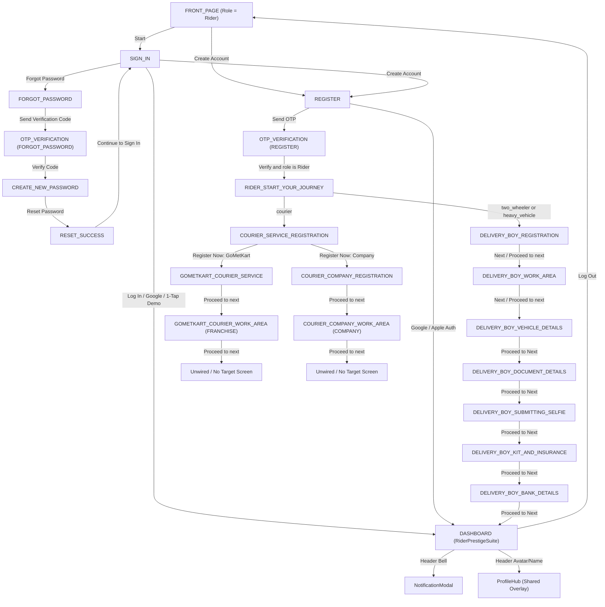
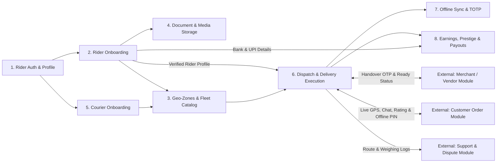
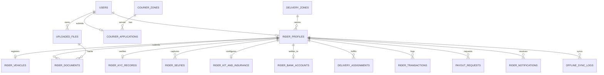

# Rider Application — System Design & Backend Requirements

> **Source Basis:** Google AI Studio React/TypeScript visual and functional prototype (`src.zip`).  
> **Scope Notice:** This document strictly reverse-engineers the **Delivery (Rider) Application** flows represented in the exported prototype (`App.tsx`, `types.ts`, Rider/Courier onboarding components, Rider operational dashboard, global offline/network utilities, and Rider-touching cross-module screens). No generic features or assumptions have been added beyond what is either explicitly shown in the UI or strictly required by the backend to support it.

--- 

## Traceability Tags Used in This Document

* **`[EXPLICIT IN DESIGN]`** — Screens, inputs, buttons, conditional visibility, hardcoded data, client validations, and navigation transitions literally present in the Google AI Studio codebase.
* **`[INFERRED BACKEND REQUIREMENT]`** — Backend modules, endpoints, schemas, security rules, and data persistence strictly required to make the explicit UI interactions function in production.
* **`[AMBIGUITY / NEEDS CLARIFICATION]`** — Incomplete navigation, un-wired buttons, conflicting prototype components, missing business rules, or hardcoded demo values that require product/stakeholder confirmation before backend implementation.

---

## 1. Application Overview & Functional Scope

### 1.1 Platform Context
MetKart (also branded **GoMetKart** across Rider/Courier onboarding screens and **METDOX** in the footer) is a multi-role ecosystem (`Customer`, `Vendors`, `Rider`) selected on `FrontPage.tsx`. Selecting **`Rider`** routes the user into the Rider Authentication, Onboarding, and Operational Fulfillment experiences.

### 1.2 Functional Scope Represented in the Prototype

1. **Authentication & Account Recovery (`[EXPLICIT IN DESIGN]`)**
   * Role selection (`Rider`) on the Landing / Front Page.
   * Sign In with Email + Password, Remember Me, Demo Fill / 1-Tap Demo, Google quick login, and Forgot Password link.
   * Create Account with Email + Password $\to$ Send OTP $\to$ 6-digit OTP Verification (with 43s resend timer) $\to$ Role-gated post-OTP routing (`selectedRole === 'Rider'` routes to `RIDER_START_YOUR_JOURNEY`), plus Google/Apple social buttons.
   * Password Recovery flow (`ForgotPassword` $\to$ `OtpVerification` $\to$ `CreateNewPassword` $\to$ `ResetSuccess` $\to$ `SignIn`).

2. **Ride Type Branching (`[EXPLICIT IN DESIGN]`)**
   * `RiderStartYourJourneyPage` lets the Rider select among 3 branches:
     * **Two-Wheeler Rider** (`two_wheeler`) $\to$ Delivery Boy Onboarding Flow.
     * **Heavy-Vehicle Rider** (`heavy_vehicle`) $\to$ Delivery Boy Onboarding Flow (with heavy-vehicle options & commercial documents).
     * **Courier Service** (`courier`) $\to$ Courier Service Onboarding Flow.

3. **Delivery Boy Onboarding Flow — Two-Wheeler & Heavy-Vehicle (`[EXPLICIT IN DESIGN]`)**
   * Read-only required documents checklist + Delivery Service Type selection (`FOOD_DELIVERY`, `GROCERY_DELIVERY`, `BOTH_DELIVERIES` for two-wheeler; `HEAVY_DELIVERY`, `SCRAP_PICKER`, `BOTH_DELIVERIES` for heavy vehicle).
   * Operational Work Area Zone selection (with map & searchable zone list) + Vehicle Type selection + conditional Vehicle Ownership Status (for heavy vehicles).
   * Dynamic Vehicle Details & Document Upload form with 4 variants (`Heavy Vehicle`, `Motorcycle / scooty`, `Electric Vehicle (EV)` High/Low Speed, `Cycle / Rental Service`).
   * Identity KYC Verification (`Aadhaar` OTP flow + card upload OR `PAN & Address Proof` manual flow + PAN upload).
   * Live Camera Selfie Verification (`Guidelines` $\to$ `Camera Capture` with face detection $\to$ `Review/Retake` $\to$ `Verified`).
   * Rider Welcome Kit (Insulated Bag + 2 T-Shirts) Delivery Address & Medical/Accidental Insurance Nominee Details.
   * Settlement Bank Account, Passbook/Cancelled Cheque upload, and UPI VPA details $\to$ transitions into `DASHBOARD` as role `Rider`.

4. **Courier Service Onboarding Flow (`[EXPLICIT IN DESIGN]` — Incomplete at End of Flow)**
   * Selection between **GoMetKart Courier Service** (Franchise partner: `Pincode / Area Franchise`, `Booking & Collection Counter`, `Hub / Zonal Warehouse Partner`) and **Register Your Courier Service Company** (`Sole Proprietorship`, `Partnership Firm / LLP`, `Private Limited Company`).
   * Operational Zone hub + Fleet selection (`Light Delivery Fleet`, `Medium Cargo Fleet`, `Heavy Transporter Fleet`, `All delivery Fleet service`).
   * Terminates after `Proceed to next` on `CourierWorkAreaOperationsPage` with no target screen wired (`[AMBIGUITY / NEEDS CLARIFICATION]`).

5. **Operational Rider Dashboard (`RiderPrestigeSuite` inside `Dashboard`) (`[EXPLICIT IN DESIGN]`)**
   * Online/Offline duty status toggle (`GO ONLINE` / `GO OFFLINE`).
   * Online idle standby with Live High Demand Map & Daily Target Goals tracker.
   * Incoming trip offer alerting with 15-second countdown, guaranteed payout breakdown (`Base Payout`, `Rider Tip`, `Green Bonus`), `PASS OFFER` / `ACCEPT TRIP`.
   * 3-phase trip execution with tactile swipe sliders (`routing_to_store` $\to$ `at_store` $\to$ `routing_to_customer` $\to$ `completed_summary`).
   * Offline verification mode (`offline_verify`) using a 4-digit customer TOTP (`OfflineEngine.ts`) + QR scan button and offline action queue sync.
   * Gamified Prestige Tier (`GOLD STAR RIDER`, Acceptance Rate, Rating, Carbon Trips, `PLATINUM AT 25 TRIPS` progress).
   * Settlement earnings card with `Instant Payout` modal workflow.
   * Shared Dashboard header actions: Notifications (`NotificationModal`), Profile Hub (`ProfileHub` — customer-shared menu), and Sign Out.

6. **Orphaned / Alternative Rider Components Found in Source (`[EXPLICIT IN DESIGN]` / `[AMBIGUITY / NEEDS CLARIFICATION]`)**
   * `RiderOnboardingWizard.tsx`: Unwired 8-step alternative onboarding modal (includes DigiLocker, `₹49` / `₹599` / `₹1,399` onboarding fee payment, orientation video + compliance quiz, and `Under Review` screen).
   * `DeliveryBoyInsuranceNomineePage.tsx`: Unwired standalone nominee screen superseded by the accordion inside `DeliveryBoyKitInsurancePage.tsx`.
   * `OnboardingPermissions.tsx`: Unwired 5-permission prompt flow (`location`, `notifications`, `phone`, `camera`, `microphone`).

### 1.3 End-to-End Prototype Navigation Flow

---

## 2. Screen-by-Screen Functionality Analysis

### 2.1 Authentication & Account Recovery Screens

#### S01: Front Page (`FRONT_PAGE` — `FrontPage.tsx`)
* **Displayed Data (`[EXPLICIT IN DESIGN]`):**
  * METDOX Eco-System badge, `v2.4 Live` indicator, MetKart brand logo & tagline.
  * 4-slide feature carousel (`Turn Waste into Wallet`, `Hyperlocal Green Commerce`, `EV Mechanics & Fleet`, `100% Offline Mesh Mode`).
  * Role selector capsules: `Customer`, `Vendors`, `Rider` (`selectedRole`).
* **User Interactions:**
  * Selecting `Rider` capsule sets `selectedRole = 'Rider'`.
  * `Start (Login)` CTA navigates to `SIGN_IN`.
  * `Create Account` button navigates to `REGISTER`.

#### S02: Sign In (`SIGN_IN` — `SignIn.tsx`)
* **Form Fields (`[EXPLICIT IN DESIGN]`):**
  * `Email Address` (text/email, trimmed, must contain `@` and `.`).
  * `Password` (password with show/hide eye toggle, minimum length `6`).
  * `Remember me` checkbox (default `true`).
* **User Actions & Conditional Behavior:**
  * `Demo Fill` button fills `rider@metkart.com` / `MetKart@2026`.
  * `Forgot Password?` navigates to `FORGOT_PASSWORD`.
  * `Create Account` navigates to `REGISTER`.
  * `Log In` submit (`handleLogin`): validates email & password; in `App.tsx` (`onSignInSuccess={handleSignInDirect}`), immediately constructs a mock `UserDetails` and navigates to `DASHBOARD`. *(Note: `onSubmit={handleSignInOtpTrigger}` exists in `App.tsx` to route `SIGN_IN` through `OTP_VERIFICATION`, but `SignIn.tsx` prioritizes `onSignInSuccess` when present.)*
  * `Google` and `1-Tap Demo` buttons immediately call `onSignInSuccess`.
  * `Home` back button returns to `FRONT_PAGE`.
* **Inferred Backend Requirement:** Authenticate Rider via email + password (and optional Google OAuth), return JWT tokens + onboarding status (`completedSteps` / current stage / approval status) so returning incomplete riders resume onboarding rather than entering an active dashboard prematurely (`[AMBIGUITY / NEEDS CLARIFICATION]`).

#### S03: Create Account / Register (`REGISTER` — `Register.tsx`)
* **Form Fields (`[EXPLICIT IN DESIGN]`):**
  * `Email` (text input; prototype only validates non-empty `cleanEmail` — note placeholder `deo` and `Demo Fill` sets `'deo'`, though subsequent OTP display assumes email format).
  * `Create Password` (password input, minimum length `6`).
* **User Actions:**
  * `Send OTP` submits email & password $\to$ sets `otpFlow = 'REGISTER'` $\to$ navigates to `OTP_VERIFICATION`.
  * `Google` / `Apple` social auth buttons call `onRegisterSuccess` $\to$ bypasses OTP and onboarding directly to `DASHBOARD` in the prototype (`[AMBIGUITY / NEEDS CLARIFICATION]`).
  * `Sign in` / `Back` navigates to `SIGN_IN`.

#### S04: Forgot Password (`FORGOT_PASSWORD` — `ForgotPassword.tsx`)
* **Form Fields (`[EXPLICIT IN DESIGN]`):**
  * `Email Address` (validated non-empty, contains `@` and `.`).
* **User Actions:**
  * `Demo Email` fills `deo@metkart.com`.
  * `Send Verification Code` sets `recoveryCredential`, sets `otpFlow = 'FORGOT_PASSWORD'`, navigates to `OTP_VERIFICATION`.
  * `Back` / `Sign In` navigates to `SIGN_IN`.

#### S05: OTP Verification (`OTP_VERIFICATION` — `OtpVerification.tsx`)
* **Displayed Data & Fields (`[EXPLICIT IN DESIGN]`):**
  * Displays masked/raw `recoveryCredential` target.
  * 6 single-digit numeric OTP boxes with backspace navigation.
  * `43`-second countdown timer (`Resend in 00:43`), revealing `Resend OTP` / `Resend Code` when timer reaches `0`.
  * `Auto-fill Code (123456)` demo helper.
  * Conditional helper banner & button text based on `flow` (`REGISTER` vs `FORGOT_PASSWORD`).
* **Routing Logic on `Verify` (`App.tsx`):**
  * `otpValue.length === 6` required.
  * When `selectedRole === 'Rider'` $\to$ navigates to **`RIDER_START_YOUR_JOURNEY`** (even in forgot-password check — note `App.tsx` line 123 checks `if (selectedRole === 'Rider')` *before* checking `otpFlow === 'FORGOT_PASSWORD'`! Flagged as `[AMBIGUITY / NEEDS CLARIFICATION]`).
  * Intended `FORGOT_PASSWORD` branch routes to `CREATE_NEW_PASSWORD`.

#### S06 & S07: Create New Password & Reset Success (`CreateNewPassword.tsx`, `ResetSuccess.tsx`)
* **Fields (`[EXPLICIT IN DESIGN]`):** `New Password` (min `6` chars, UI also checks digit indicator), `Confirm Password` (must match `New Password`), show/hide toggles.
* **Actions:** `Reset Password` navigates to `RESET_SUCCESS`, whose `Continue to Sign In` navigates to `SIGN_IN`.

---

### 2.2 Rider Journey Entry Screen

#### S08: Start Your Journey (`RIDER_START_YOUR_JOURNEY` — `RiderStartYourJourneyPage.tsx`)
* **Displayed Options (`[EXPLICIT IN DESIGN]`):** Single-select radio cards (default `two_wheeler`):
  1. `two_wheeler` — **Two-Wheeler Rider**: "Bikes, scooters, and cycles for quick and agile deliveries."
  2. `heavy_vehicle` — **Heavy-Vehicle Rider**: "Large vehicles, vans, and trucks for bulk and heavy transport."
  3. `courier` — **Courier Service**: "Door-to-door parcel, document, and package delivery services."
* **Navigation:**
  * `Back` $\to$ `OTP_VERIFICATION`.
  * `Register as Rider` $\to$ saves `selectedRiderVehicleType`. If `'courier'`, navigates to `COURIER_SERVICE_REGISTRATION`; otherwise navigates to `DELIVERY_BOY_REGISTRATION`.

---

### 2.3 Delivery Boy Onboarding Branch (Two-Wheeler & Heavy-Vehicle)

#### S09: Delivery Boy Registration & Service Type (`DELIVERY_BOY_REGISTRATION` — `DeliveryBoyRegistrationPage.tsx`)
* **Read-Only Document Checklist (`[EXPLICIT IN DESIGN]`):**
  * `Aadhaar Card*` (mandatory)
  * `Pan Card (If Applicable)`
  * `Driving license`
  * `RC (Registration for vehicle)`
  * `Bank Account Details`
* **Conditional Service Type Options (`DeliveryPreference`, default `BOTH_DELIVERIES`):**
  * When `riderRideType === 'two_wheeler'`:
    * `FOOD_DELIVERY` ("Food Delivery")
    * `GROCERY_DELIVERY` ("Grocery Delivery")
    * `BOTH_DELIVERIES` ("Both Deliveries")
  * When `riderRideType === 'heavy_vehicle'` (Header adds `"Heavy Vehicle Rider"` subtitle):
    * `HEAVY_DELIVERY` ("Delivery Boy (Heavy-Food/Grocery/Goods)")
    * `SCRAP_PICKER` ("Scrap Picker Boy (Bulk Heavy Scrap)")
    * `BOTH_DELIVERIES` ("Both Deliveries")
* **Actions:**
  * `Back` $\to$ `RIDER_START_YOUR_JOURNEY`.
  * `Next` / `Proceed to next` $\to$ saves `deliveryPreference` and navigates to `DELIVERY_BOY_WORK_AREA`.

#### S10: Work Area & Vehicle (`DELIVERY_BOY_WORK_AREA` — `DeliveryBoyWorkAreaPage.tsx`)
* **Displayed Data & Sub-Sections (`[EXPLICIT IN DESIGN]`):**
  * **Header:** `Work Area & Vehicle`, subtitle `{Two Wheeler Rider | Heavy Vehicle Rider} Registration`.
  * **Auto-Assigned Role Card:** Displays `Delivery Boy`, `Verified Role` badge, dynamically computed role title (`Food Delivery Partner`, `Grocery Delivery Partner`, `Food & Grocery Delivery Partner`, `Delivery Boy (Heavy-Food/Grocery/Goods)`, `Scrap Picker Boy (Bulk Heavy Scrap)`, `Both Deliveries (Heavy Goods & Bulk Scrap)`), and status `Auto-assigned`.
  * **Work Area Zone Selector + Map:**
    * Displays interactive Google Map (if `VITE_GOOGLE_MAPS_API_KEY` set) or vector map fallback showing selected zone center (`lat`, `lng`), radius, `city`, `activeOrders+ orders`.
    * `Change` button toggles inline search bar & scrollable zone list (`filteredZones` matching `name` or `city`).
    * Prototype hardcoded `AVAILABLE_ZONES` (6 Hyderabad zones): `zone-medipally`, `zone-hitech`, `zone-gachibowli`, `zone-banjara`, `zone-secunderabad`, `zone-kukatpally`, with `id`, `name`, `city`, `radiusKm`, `demand` (`'High' | 'Very High' | 'Surge'`), `activeOrders`, `coords { lat, lng }`.
  * **Choose Vehicle (`Required`, single-select):**
    * Two-Wheeler options (default `'Motorcycle / scooty'`):
      * `'Motorcycle / scooty'` (Badge: `Most Popular`)
      * `'Electric Vehicle (EV)'` (Badge: `Green Bonus`)
      * `'Cycle / Rental Service'` (Badge: `No DL Needed`)
    * Heavy-Vehicle options (default `'Commercial 4-Wheeler...'`):
      * `'Commercial 3-Wheeler Auto / Cargo Loader (e.g., Piaggio Ape, Bajaj Maxima)'` (`Cargo 3W`)
      * `'Electric Cargo / Heavy EV (e.g., Euler HiLoad, Mahindra Zor Grand)'` (`Green Cargo`)
      * `'Commercial 4-Wheeler (e.g., Tata Ace / Chhota Hathi, Mahindra Bolero Pik-Up)'` (`Most Popular`)
      * `'Heavy Freight / Container Truck'` (`Heavy Freight`)
  * **Conditional Vehicle Ownership Status (only when `isHeavyVehicle` is true; default `'Self-Owned'`):**
    * `'Self-Owned'`
    * `'Rented / Leased'`
    * `'Fleet / Company Drivers'`
* **Actions:**
  * `Back` $\to$ `DELIVERY_BOY_REGISTRATION`.
  * `Next` / `Proceed to next` $\to$ passes `{ workArea, vehicleType, vehicleOwnership?, zoneDetails }` to `App.tsx` and navigates to `DELIVERY_BOY_VEHICLE_DETAILS`.

#### S11: Vehicle Details (`DELIVERY_BOY_VEHICLE_DETAILS` — `DeliveryBoyVehicleDetailsPage.tsx`)
Renders one of **4 distinct conditional forms** based on `riderRideType` and `vehicleType` (`[EXPLICIT IN DESIGN]`):

1. **Variant 1 — Heavy Vehicle (`isHeavyVehicle` is true):**
   * Summary banner displaying `Heavy Vehicle Rider`, `vehicleOwnership`, `vehicleType`, format `Commercial`.
   * **Card 1 (Heavy Vehicle Information):**
     * `Vehicle Owner Name*` (`ownerName`, text, required).
     * `Registration Number*` (`vehicleNumber`, auto-uppercase, required, visual hint `>= 6` chars).
     * `Vehicle Brand & Model*` (`brandModel` dropdown of 10 models + `Other` revealing custom text input `customHeavyBrand`).
     * `Fuel Type*` (`fuelType` select: `'Diesel' | 'CNG' | 'Petrol' | 'Electric Heavy'`).
     * `Load Capacity (Payload in Kg/Tons)*` (`loadCapacity`, text, required, e.g. `750 Kg`).
     * `Commercial Permit Type*` (`permitType` select: `'Intra-State' | 'National Permit'`).
   * **Card 2 (Driver License):**
     * `Driving License (DL) Number*` (`dlNumber`, uppercase, required).
     * `DL License Badge / Category*` (`dlBadge` 3-option radio: `'LMV-NT (Light Motor Vehicle Non-Transport)'`, `'LMV-TR / TRANS (Transport / Commercial)'`, `'Heavy Transport Vehicle (MCWG/HMV)'`).
     * `DL Expiry Date*` (`dlExpiryDate`, date input, required).
   * **Card 3 (Document Verification Uploads — Camera & Files Allowed):**
     1. `Commercial Driving License (DL)` (`commercialDlPhoto`) — Front & Back photo
     2. `Vehicle RC (Registration Certificate)` (`commercialRcPhoto`) — Commercial RC copy
     3. `Vehicle Commercial Insurance` (`commercialInsurancePhoto`)
     4. `Fitness Certificate (FC)` (`fitnessCertificatePhoto`)
     5. `Permit Document` (`permitDocPhoto`)
     6. `Pollution Certificate (PUC)` (`pucPhoto`)

2. **Variant 2 — Motorcycle / Scooty (`vehicleType === 'Motorcycle / scooty'`):**
   * **Card 1:** `Vehicle Number*` (`vehicleNumber`, uppercase, required), `Brand & Model Name*` (6 quick buttons + `Other Model` custom input), `Fuel Type` (read-only pre-selected `Petrol`), `Driving License (DL) Number*` (`dlNumber`, uppercase, required), `DL Expiry Date*` (`dlExpiryDate`, date, required).
   * **Card 2 (Documents Upload):**
     1. `Driving License Front & Back Photo` (`dlPhoto`)
     2. `Vehicle RC (Registration Certificate) Photo` (`rcPhoto`)
     3. `Vehicle Insurance Photo` (`insurancePhoto`, labeled **`Optional`**)

3. **Variant 3 — Electric Vehicle (`vehicleType === 'Electric Vehicle (EV)'`):**
   * **Card 1:**
     * `EV Category*` (`evCategory`: `'HIGH_SPEED'` [License & RC Needed, Speed > 25 km/h] vs `'LOW_SPEED'` [No License Needed, Speed <= 25 km/h]).
     * Conditional `Vehicle Number*` (`evVehicleNumber`, shown/required only if `evCategory === 'HIGH_SPEED'`).
     * `Brand & Model Name*` (6 quick buttons: `Ola S1`, `TVS iQube`, `Ather 450X`, `Hero Electric`, `Bajaj Chetak`, `Other EV`).
     * Conditional `Driving License Number*` (`evDlNumber`, shown/required only if `evCategory === 'HIGH_SPEED'`).
   * **Card 2 (Documents Upload):**
     1. `DL Photo (High-Speed EV)` (`evDlPhoto`, shown only if `HIGH_SPEED`)
     2. `Vehicle RC / Purchase Bill Photo` (`evRcBillPhoto`)
     3. `Id Proof (Aadhaar Card)` (`evIdProofPhoto`)

4. **Variant 4 — Cycle / Rental Service (`vehicleType === 'Cycle / Rental Service'`):**
   * **Card 1:** `Cycle/Rental Scooty Type*` (`cycleType`: `'STANDARD'` vs `'ELECTRIC'`), `Brand/Model Name (Optional)` (`cycleBrandModel`).
   * **Card 2 (Documents Upload):**
     1. `Photo of the Cycle` (`cyclePhoto`, labeled **`Optional`**)
     2. `Id Proof (Aadhaar Card / Voter ID)` (`cycleIdProofPhoto`)

* **Actions:** `Back` $\to$ `DELIVERY_BOY_WORK_AREA`; `Proceed to Next` $\to$ stores `selectedVehicleData` and navigates to `DELIVERY_BOY_DOCUMENT_DETAILS`.

#### S12: Document Details / Identity KYC (`DELIVERY_BOY_DOCUMENT_DETAILS` — `DeliveryBoyDocumentDetailsPage.tsx`)
* **Selection (`Select ID`, `[EXPLICIT IN DESIGN]`):**
  * `'AADHAAR'` — **I have an Aadhaar** ("Fastest digital verification via OTP")
  * `'PAN_AND_ADDRESS'` — **I don't have Aadhaar** ("Submit PAN and address proof")
* **Flow 1: `'AADHAAR'`:**
  * `Aadhaar Number*` formatted `XXXX XXXX XXXX` (12 numeric digits required before `Send OTP`; disabled once verified).
  * `Send OTP` button $\to$ reveals inline OTP verification card with `45s` timer, `6`-digit `otpValue` input, notice `"Note: OTP sent to Aadhaar linked WhatsApp / mobile number. (N attempts left)"` initialized at `3` attempts, `Verify OTP` button, `Resend` button (enabled when timer = `0`, decrements `otpAttemptsLeft`).
  * Verified state displays green card with `Full Name`, `Aadhaar Number`, and `Wrong Aadhaar? (Change)` reset button.
  * **Card 2 — Upload Your Aadhaar:** File picker accepting `.jpg,.jpeg,.png` (`JPEG, PNG, JPG with size less than 5 MB`), image thumbnail preview, file name/size, `Upload` / `Re-upload` button + guidelines box.
* **Flow 2: `'PAN_AND_ADDRESS'`:**
  * `PAN NUMBER*` (uppercase, required).
  * `FULL NAME AS PER PAN*` (required).
  * `FULL ADDRESS OF YOUR REGISTRATION*` (textarea, required).
  * Live summary box showing `Name` and `PAN Number`.
  * **Card 2 — Upload Your PAN:** File picker accepting `.jpg,.jpeg,.png` (`< 5 MB`), preview, `Upload` / `Re-upload` button + guidelines box.
* **Actions:** `Back` $\to$ `DELIVERY_BOY_VEHICLE_DETAILS`; `Proceed to Next` $\to$ validates Aadhaar verified (if `AADHAAR`) or PAN+Name+Address present (if `PAN_AND_ADDRESS`), stores `selectedDocumentData`, navigates to `DELIVERY_BOY_SUBMITTING_SELFIE`.

#### S13: Submitting Selfie (`DELIVERY_BOY_SUBMITTING_SELFIE` — `DeliveryBoySubmittingSelfiePage.tsx`)
4 internal UI states (`[EXPLICIT IN DESIGN]`):
1. `GUIDELINES`: 3 numbered illustrated guidelines (`1. Image should be clear`, `2. Wear proper clothes`, `3. Click without mask and helmet`), camera permission banner, `Take Selfie` button $\to$ transitions to `CAMERA`.
2. `CAMERA`: Requests `getUserMedia` front-facing video stream (`facingMode: 'user'`), circular frame + head silhouette guide overlay, simulated face-detection status (`Align your face inside the circle...` $\to$ `Face detected, Please wait`), shutter button `Click Now` captures image frame $\to$ transitions to `CAPTURED`.
3. `CAPTURED`: Circular photo preview, `Retake` ($\to$ `CAMERA`) and `Submit` ($\to$ `VERIFIED`) buttons.
4. `VERIFIED`: `"Verified Selfie Submitted"` card (`Face matched & authenticated`, thumbnail, timestamp), `Change` / `Wrong photo added? (Change)` ($\to$ `CAMERA`), and `Proceed to Next` $\to$ stores `selectedSelfieUrl`, navigates to `DELIVERY_BOY_KIT_AND_INSURANCE`.
* **Header Back Behavior:** From `CAMERA` or `CAPTURED`, returns to `GUIDELINES`; from `GUIDELINES` or `VERIFIED`, navigates back to `DELIVERY_BOY_DOCUMENT_DETAILS`.

#### S14: Rider Kit & Insurance (`DELIVERY_BOY_KIT_AND_INSURANCE` — `DeliveryBoyKitInsurancePage.tsx`)
* **Card 1 — Highlight for the Details (Read-Only Benefits, `[EXPLICIT IN DESIGN]`):**
  * `Bag with t-shirts` — Insulated bag + 2 official rider dry-fit T-shirts
  * `Medical insurance 1 lakh` — `₹1,00,000` cashless hospitalization coverage
  * `Accidental life insurance 10 lakh` — `₹10,00,000` 24/7 on-duty accidental life cover
* **Card 2 — Delivery Address for Bag & T-shirt (with Kit Photo):**
  * `House no.*` (`houseNo`, text, required)
  * `Area, street*` (`areaStreet`, text, required)
  * `Pin code*` (`pincode`, numeric max 6 digits, required)
  * `Town city*` (`townCity`, text, required)
  * `Select State*` (`state` dropdown: 15 Indian states — Telangana, Andhra Pradesh, Delhi NCR, Maharashtra, Karnataka, Tamil Nadu, Uttar Pradesh, West Bengal, Gujarat, Rajasthan, Kerala, Madhya Pradesh, Bihar, Punjab, Haryana)
* **Card 3 — Add Details for Your Insurance (with Family Photo + Expandable Dropdown):**
  * Toggle button `Add Details (Insurance Nominee Details)` expands/collapses the nominee form (`isNomineeFormOpen`).
  * Nominee Fields (all required):
    * `Nominee name*` (`nomineeName`)
    * `Nominee relationship*` (`nomineeRelationship`: `Spouse`, `Father`, `Mother`, `Son`, `Daughter`, `Brother`, `Sister`, `Other`)
    * `Nominee date of birth*` (`nomineeDob`, `<input type="date">`, UI note: `Nominee must be 18+ years`)
    * `Nominee mobile number*` (`nomineeMobile`, `+91` prefix, numeric max 10 digits)
    * `Emergency mobile number*` (`emergencyMobile`, `+91` prefix, numeric max 10 digits)
* **Actions:** `Back` $\to$ `DELIVERY_BOY_SUBMITTING_SELFIE`; `Proceed to Next` $\to$ validates all address & nominee fields (auto-opens accordion if nominee fields missing), stores `selectedKitAddress` & `selectedNomineeData`, navigates to `DELIVERY_BOY_BANK_DETAILS`.

#### S15: Bank Account Details (`DELIVERY_BOY_BANK_DETAILS` — `DeliveryBoyBankAccountDetailsPage.tsx`)
* **Card 1 — Bank Account Details (`[EXPLICIT IN DESIGN]`):**
  * `Bank Account Number*` (`accountNumber`, numeric, masked password toggle with Eye/EyeOff icon, required).
  * `Re-enter Bank Account Number*` (`reAccountNumber`, numeric, required; shows inline `"Account numbers do not match"` error on mismatch).
  * `Enter IFSC Code*` (`ifscCode`, uppercase trimmed, required, displays verified checkmark + `bankBranchName`).
  * `Account Type*` (`accountType`: `'Savings A/C'` | `'Current A/C'`).
* **Card 2 — Passbook & Cancel Cheque Details:**
  * File upload (`accept=".pdf,.jpg,.jpeg,.png"`, UI note: `"Accepted formats: PDF, JPEG, PNG (under 5 MB)"`), displays file name, size in MB, and `Re-upload` button.
* **Card 3 — UPI Details:**
  * `Enter UPI ID / VPA*` (`upiId`, required, shows `Verified` pill badge, Supported badges: `Google Pay`, `PhonePe`, `Paytm`, `BHIM`).
* **Bottom Disclaimer & Submit:**
  * `Back` $\to$ `DELIVERY_BOY_KIT_AND_INSURANCE`.
  * `Proceed to Next` $\to$ passes `bankData` to `App.tsx`, constructs `mockRiderUser` (`fullName` from document data, `role: 'Rider'`, vehicle/workArea/preference fields, `avatarUrl` from selfie), sets `currentUser` and navigates directly to **`DASHBOARD`**.

---

### 2.4 Courier Service Onboarding Branch (`courier`)

#### S16: Courier Service Registration (`COURIER_SERVICE_REGISTRATION` — `CourierServiceRegistrationPage.tsx`)
* **Required Documents Card (`[EXPLICIT IN DESIGN]`):**
  * `Business / Owner PAN Card*`, `GST Registration*`, `Aadhaar Card*`, `Company Incorporation Certificate / Trade License`, `Bank Account Details`, `Warehouse / Lands for Goods Storage Area (Sqr./Mtr)`.
* **2 Service Type Option Cards (each with `Register Now` button):**
  1. `GOMETKART_COURIER_SERVICE` ("GoMetKart Courier Service") $\to$ `GOMETKART_COURIER_SERVICE`.
  2. `REGISTER_COURIER_COMPANY` ("Register Your Courier Service Company") $\to$ `COURIER_COMPANY_REGISTRATION`.
* `Back` $\to$ `RIDER_START_YOUR_JOURNEY`.

#### S17: GoMetKart Courier Service (`GOMETKART_COURIER_SERVICE` — `GoMetKartCourierServicePage.tsx`)
* **Subtitle:** `FRANCHISE & PARTNER REGISTRATION`.
* **Required Documents Card (`[EXPLICIT IN DESIGN]`):**
  * `GST Certificate*`, `PAN Card (Business / Proprietor)`, `Address Proof of Outlet`, `Cancelled Cheque / Bank Details`, `Applicant Photo & ID Proof`.
* **Select Franchise Type (default `HUB_ZONAL_WAREHOUSE`):**
  1. `PINCODE_AREA_FRANCHISE` — Pincode / Area Franchise
  2. `BOOKING_COLLECTION_COUNTER` — Booking & Collection Counter
  3. `HUB_ZONAL_WAREHOUSE` — Hub / Zonal Warehouse Partner
* **Actions:** `Back` $\to$ `COURIER_SERVICE_REGISTRATION`; `Proceed to next` $\to$ saves `selectedCourierFranchiseType`, navigates to `GOMETKART_COURIER_WORK_AREA`.

#### S19: Courier Company Registration (`COURIER_COMPANY_REGISTRATION` — `CourierCompanyRegistrationPage.tsx`)
* **Subtitle:** `3PL & LOGISTICS PARTNER`.
* **Required Documents Card (`[EXPLICIT IN DESIGN]`):**
  * `GSTIN Certificate*`, `Company / Proprietor PAN Card`, `Incorporation / Trade License`, `Serviceable Pincodes List`, `Cancelled Cheque / Bank Details`.
* **Select Business Type (default `PRIVATE_LIMITED`):**
  1. `SOLE_PROPRIETORSHIP` — Sole Proprietorship
  2. `PARTNERSHIP_LLP` — Partnership Firm / LLP
  3. `PRIVATE_LIMITED` — Private Limited Company
* **Actions:** `Back` $\to$ `COURIER_SERVICE_REGISTRATION`; `Proceed to next` $\to$ saves `selectedCourierBusinessType`, navigates to `COURIER_COMPANY_WORK_AREA`.

#### S18 & S20: Courier Work Area & Operations (`GOMETKART_COURIER_WORK_AREA` / `COURIER_COMPANY_WORK_AREA` — `CourierWorkAreaOperationsPage.tsx`)
* **Mode (`'FRANCHISE' | 'COMPANY'`, `[EXPLICIT IN DESIGN]`):**
  * Displays Hub / Partner summary card (`Franchise Hub` / `Logistics Partner`, status `Pending setup` / `Setup pending`).
  * **Operation Zone Selector + Map (`COURIER_ZONES`):** 5 sample hubs (`meerut-central`, `uppal-hyderabad`, `noida-sector62`, `delhi-okhla`, `lucknow-gomtinagar`) with `id`, `name`, `pincodes`, `operations`, `coords { lat, lng }`; searchable via `Change` button.
  * **Vehicle & Service Fleet (`CourierFleetChoice`, default `'Light Delivery Fleet'`):**
    1. `Light Delivery Fleet` (Motorcycles, Scooters, E-bikes)
    2. `Medium Cargo Fleet` (3-Wheeler Auto & E-loaders)
    3. `Heavy Transporter Fleet` (4-Wheeler vans & mini trucks)
    4. `All delivery Fleet service`
* **Actions:**
  * `Back` $\to$ `GOMETKART_COURIER_SERVICE` or `COURIER_COMPANY_REGISTRATION`.
  * `Proceed to next` $\to$ saves `selectedCourierWorkAreaData` in `App.tsx`, **then stops (no target screen wired)** (`[AMBIGUITY / NEEDS CLARIFICATION]`).

---

### 2.5 Operational Rider Dashboard & Shared Overlays

#### S21: Rider Dashboard (`DASHBOARD` — `Dashboard.tsx` + `OtherRoleDashboards.tsx` + `RiderPrestigeSuite.tsx`)
* **Top Header (`Dashboard.tsx`, `[EXPLICIT IN DESIGN]`):**
  * User avatar & `Hello, <FirstName>`, member pill (`Metkart member`), static location label (`Sector 4, NCR`). Clicking avatar/name opens **`ProfileHub`**.
  * Notification Bell icon with unread count badge $\to$ opens **`NotificationModal`**.
  * Log Out icon button (rendered because `displayRole !== 'Customer'`) $\to$ clears session state and navigates to `FRONT_PAGE`.
  * Note: Customer bottom tab bar and floating Support button are explicitly hidden (`displayRole === 'Customer'`).
* **`OtherRoleDashboards.tsx` Hook:**
  * On mount when `displayRole === 'Rider'`, triggers `fetch('/api/pickups')` (though `RiderPrestigeSuite` uses local `mockOrdersList` instead of the `pickups` state).
* **`RiderPrestigeSuite.tsx` States & UI Blocks:**
  1. **Header & Duty Toggle:** Title `Rider Prestige Suite V2.4`, status text (`OFFLINE` / `WAITING FOR OFFERS`), toggle button (`GO ONLINE` / `GO OFFLINE`) with Web Audio tone cues.
  2. **Idle (`appState === 'idle'`):**
     * **When Offline:** "You are Offline" instructions + MetKart instant withdrawal guarantee card.
     * **When Online:**
       * `Live High Demand Map` card (`PEAK HOURS ACTIVE`, vector map with demand hot spots e.g. `Sector 4 (Very High)`, `Farmers Store`, rider `YOU` marker, `Expected next booking within: ~3 mins`, `Live Surge Payouts active`).
       * `Daily Target Goals` card (`₹todayEarnings / ₹800`, progress bar, `3 of 5 Rides Done`, `₹320 to unlock ₹150 Bonus`).
  3. **Incoming Offer Alert (`appState === 'alerting'`):**
     * 15-second countdown timer (auto-rejects / returns to `idle` on expiry).
     * Guaranteed Trip Payout (`estEarnings`), Route Trip Distance (`distance`, `estTime`), 3-part breakdown (`Base Payout`, `Rider Tip`, `Green Bonus`).
     * Pickup store (`storeName`, `pickupAddress`) & Drop customer (`customerName`, `dropAddress`).
     * Buttons: `PASS OFFER` (returns to `idle`), `ACCEPT TRIP` (moves to `routing_to_store`).
  4. **Phase 1 — Ride to Store (`appState === 'routing_to_store'`):**
     * Header with `EST. PICKUP` ETA (`6 mins away`).
     * Restaurant/Partner Store card (`storeName`, `pickupAddress`, `items`, `Eco Carrier Required: materials`).
     * Range slider: `SWIPE TO ARRIVE AT MERCHANT` (100% $\to$ transitions to `at_store`).
  5. **Phase 2 — Pickup Verification Handshake (`appState === 'at_store'`):**
     * `Pick up Eco Parcel Box` instructions & `PACKAGE AUDIT DETAILS` (`Order ID`, `Products`, QR/delivery dispatch note).
     * Range slider: `SWIPE TO OUT FOR DELIVERY` (100% $\to$ transitions to `routing_to_customer`).
  6. **Phase 3 — Trip to Customer (`appState === 'routing_to_customer'`):**
     * Header with `EST. REACH` ETA (`12 mins away`).
     * Customer card (`customerName`, `dropAddress`), `CALL CLIENT` (`tel:` link), `EMERGENCY CHAT` (alert stub).
     * Range slider: `SWIPE TO COMPLETE TRIP` (100% $\to$ if `isOffline === true`, transitions to `offline_verify`; else calls `completeDelivery()` and transitions to `completed_summary`).
  7. **Offline Verification (`appState === 'offline_verify'`):**
     * 4-digit TOTP input (`verifyOfflineTOTP(activeOrder.id, offlineCodeInput)` or `'1234'`), `SCAN QR` button (alert stub), `VERIFY CODE` button.
     * On success, completes delivery and queues `COMPLETED_JOB` via `OfflineEngine.queueOfflineAction`.
  8. **Completed Trip Summary (`appState === 'completed_summary'`):**
     * Shows `+₹estEarnings` wallet credit & `+points Eco PTS`, increments `todayEarnings`, `tripsCompleted`, `pointsEarnedToday`, triggers parent `onActionComplete` (updating `walletBalance`, `ecoPoints`, `carbonOffset`, `transactions`, `notifications`).
     * Button `RETURN TO HOME DASHBOARD` $\to$ resets `appState` to `'idle'`.
  9. **Gamified Performance Card (`METKART RIDER PRESTIGE TIER`):**
     * Tier badge `GOLD STAR RIDER`, 3 metrics (`Acc. Rate`, `Rating`, `Carbon Trips`), `PRESTIGE REWARDS PROGRESS` bar (`PLATINUM AT 25 TRIPS`, benefit description: `+₹15 per delivery peak bonus multiplier & zero-charge medical insurance cover`).
  10. **Settlement Earnings & Instant Payout Card:**
      * Shows `Metkart Settlement Earnings` (`balance`) and masked account (`SBI Savings Account: ****1234`).
      * `Instant Payout` button (disabled when `balance <= 10`) $\to$ opens Payout Modal (`Settling Payout Instantly` spinner $\to$ `Wages Dispatched` receipt with `Reference ID`, `Transfer Destination`, `Transferred Amount`, deducts full `balance` via `onActionComplete(-currentBalance, ...)` and clears `todayEarnings` on `DISMISS RECEIPT`).
  11. **Rider Task Bar (Bottom 6 Tabs inside `RiderPrestigeSuite`):**
      * `Home`, `Orders`, `Map`, `Earnings`, `Support`, `Profile` — **none of the 6 buttons have click handlers in the prototype** (`[AMBIGUITY / NEEDS CLARIFICATION]`).

#### S22 & S23: Shared Header Overlays Accessible to Rider (`NotificationModal.tsx`, `ProfileHub.tsx`)
* **`NotificationModal.tsx`:** Displays notification list (`id`, `title`, `description`, `time`, `type: 'eco' | 'wallet' | 'service' | 'alert'`, `read`), `Mark all read`, and delete notification (`X`).
* **`ProfileHub.tsx`:** Accessible when tapping header avatar/name. Contains `Edit profile` modal (`fullName`, `phone`, `email`, `address` + `avatarUrl`), `Log Out` confirmation modal, and 12 menu items (`Your Orders` $\to$ `MyEcoOrdersPage`, `Address Book`, `Metkart Wallet` $\to$ `MetKartEcoFlow`, `Payment Settings`, `Your Wishlist`, `Refer and Earn` $\to$ `ReferralFlow`, `Gift Cards`, `About Metkart`, `Accessibility`, `Help & Support` $\to$ `SupportCenter`, `Settings`, `Log Out`). Note: Many items in `ProfileHub` use customer copy (`Customer Name`, Wishlist, Address Book) rather than Rider-specific data (`[AMBIGUITY / NEEDS CLARIFICATION]`).

#### S24: Global Network / Offline State & Sync (`NetworkContext.tsx`, `OfflineEngine.ts`, `MobileFrame.tsx`, `SyncStatus.tsx`)
* Tracks browser online/offline & connection speed (`ONLINE_HIGH_SPEED` | `ONLINE_LOW_SPEED` | `OFFLINE`).
* Shows offline banner (`Offline Mode Active — Orders & Routing operational via Bluetooth/SMS`) and `SyncStatus` toast when syncing queued actions back online (`POST` queue sync inferred).

---

### 2.6 Unwired / Orphaned Components Found in `src.zip` (`[AMBIGUITY / NEEDS CLARIFICATION]`)

These files exist in `src.zip` and target the Rider/Onboarding domain, but are **not reachable** in `App.tsx`:

1. **O1 — `DeliveryBoyInsuranceNomineePage.tsx` (`DELIVERY_BOY_INSURANCE_NOMINEE` in `types.ts`):** Standalone screen for Insurance Nominee Details (`nomineeName`, `nomineeRelationship`, `nomineeDob`, `nomineeMobile`, `emergencyMobile`). Superseded in `App.tsx` by the collapsible Nominee accordion inside `DeliveryBoyKitInsurancePage.tsx`.
2. **O2 — `RiderOnboardingWizard.tsx`:** Alternative 8-step Rider onboarding wizard containing flows **not present** in the active `App.tsx` Rider path:
   * Step 1: Prerequisites.
   * Step 2: Delivery option (`food` | `grocery` | `both`).
   * Step 3: City (`Mumbai`, `Delhi NCR`, `Bangalore`, `Pune`, `Chennai`, `Kolkata`), Zone (`Central Block`, `North Block`, `South Block`, `East Block`, `West Block`), Vehicle (`motorcycle`, `ev`, `bicycle`).
   * Step 4: Full Name, DOB, Pincode, Local Current Address; Aadhaar DigiLocker verification + separate Aadhaar Front/Back uploads; PAN Card (optional); DL & RC (for motorcycle); Selfie.
   * Step 5: Bank Name, Account Number, IFSC Code, Cancelled Cheque/Passbook upload.
   * Step 6: **Onboarding & Bag Fee Payment** (`₹599/-` Upfront vs `₹1,399/-` EMI deduction, with `₹49/-` refundable booking deposit payment gateway button).
   * Step 7: **Orientation Video & 2-Question Safety Compliance Quiz**.
   * Step 8: **Application Under Review (24-48 Hours)** + Bag & T-Shirt Kit Dispatch status.
3. **O3 — `OnboardingPermissions.tsx` (`ONBOARDING_PERMISSIONS` in `types.ts`):** 5-step permission walkthrough (`location`, `notifications`, `phone`, `camera`, `microphone`).

---

## 3. Module-Wise Backend Architecture

*(Section 3 specifies `[INFERRED BACKEND REQUIREMENT]` unless tagged `[EXPLICIT IN DESIGN]`.)*

### 3.1 Module Breakdown & Responsibilities

| Backend Module | Primary Responsibilities | Key Prototype Screens Served |
| :--- | :--- | :--- |
| **1. Rider Auth & Profile Module** | Email/password signup, email/recovery OTP generation & verification (43s resend cooldown), password reset, JWT session issuance (`Remember me` TTL vs short TTL), Rider social OAuth (Google/Apple if enabled), Rider core profile updates, notification bell list management. | S01–S07, S22, S23 |
| **2. Rider Onboarding Module** | Multi-step onboarding state machine (`RIDE_TYPE` $\to$ `PREFERENCE` $\to$ `WORK_AREA` $\to$ `VEHICLE` $\to$ `IDENTITY` $\to$ `SELFIE` $\to$ `KIT_NOMINEE` $\to$ `BANK`), conditional validation per vehicle/ride variant, Aadhaar OTP KYC gateway integration, PAN+Address persistence, selfie liveness/face-match verification, welcome kit dispatch address & insurance nominee storage, bank/IFSC/UPI validation & storage. | S08–S15 |
| **3. Geo-Zones & Fleet Catalog Module** | Manage operational delivery zones (`AVAILABLE_ZONES`: city, radius, coordinates, live demand tier, active order count), courier hub zones (`COURIER_ZONES`: pincodes, operation mode), zone search, and heatmap/demand hotspot feed for idle online riders. | S10, S18, S20, S21 |
| **4. Document & Media Storage Module** | Handle multipart file uploads (`JPEG`, `PNG`, `JPG`, `PDF` max 5 MB), store metadata and secure object URLs/keys for DL, RC, Insurance, Fitness Certificate, Permit, PUC, EV Purchase Bill, ID Proof, Cycle Photo, Aadhaar, PAN, Selfie capture, and Passbook/Cancelled Cheque. | S11, S12, S13, S15 |
| **5. Courier Partner / Franchise Onboarding Module** *(flagged incomplete in UI)* | Persist courier service branch selection (`GoMetKart Franchise` vs `3PL Company`), franchise/business sub-type, operational hub zone, and fleet selection; requires follow-up definition for remaining courier document/bank screens. | S16–S20 |
| **6. Dispatch, Shift & Delivery Execution Module** | Track rider duty status (`ONLINE` / `OFFLINE`) & daily goals, dispatch incoming trip offers with 15s accept/reject SLA, manage trip state transitions (`ASSIGNED` $\to$ `ARRIVED_AT_MERCHANT` $\to$ `OUT_FOR_DELIVERY` $\to$ `DELIVERED`), verify merchant handover OTP & customer delivery confirmation. | S21 + Vendor/Customer touchpoints |
| **7. Offline Sync & TOTP Verification Module** | Derive/validate deterministic 10-minute-window 4-digit TOTP codes for offline delivery handshakes (`OfflineEngine.ts`), ingest batched offline action queues (`COMPLETED_JOB` / SMS payloads) when connectivity resumes with idempotency protection. | S21 (`offline_verify`), S24 |
| **8. Rider Earnings, Prestige & Settlement Module** | Maintain rider wallet balance, eco-points, carbon-offset totals, trip earnings ledger (base pay + tip + green bonus), daily target bonus tracking, acceptance rate / star rating / prestige tier (`GOLD` $\to$ `PLATINUM`), bank/UPI payouts (`/api/wallet/withdraw` or instant payout endpoint). | S21 (Targets, Prestige, Instant Payout), S23 |

### 3.2 Module Dependency & Cross-Module Interactions

* **External / Cross-Module Touchpoints Found in Prototype (`[EXPLICIT IN DESIGN]`):**
  * **Merchant / Vendor Module (`VendorOptionPages.tsx`):** Shows assigned Rider (`name`, `id`, `Arrived at Outlet`), **Handover OTP (`4921`)**, and `Handover to Rider` confirmation when transitioning orders from `Food Packed` / `Pickup Desk`.
  * **Customer Order Module (`FoodMarketplaceFlow.tsx`, `GroceryFlow.tsx`, `MyEcoOrdersPage.tsx`, `Dashboard.tsx`):** Consumes assigned Rider profile (`name`, `id`, `rating`, `avatar`), live GPS progress/distance/ETA, bidirectional Customer $\leftrightarrow$ Rider chat, Customer-to-Rider rating (1–5 stars + tags + comment), and displays the 4-digit `Offline Delivery PIN` matching the Rider's `offline_verify` TOTP check.
  * **Scrap Pickup API (`OtherRoleDashboards.tsx`):** Fetches `GET /api/pickups` for both `'Rider'` and `'Scrap Picker'`, indicating heavy-vehicle riders who select `SCRAP_PICKER` or `BOTH_DELIVERIES` may interact with household scrap pickup assignments.
  * **Support & Disputes (`SupportCenter.tsx`):** References Rider/Courier route logs and weighing scale logs during dispute audits.

### 3.3 Authentication & Authorization Requirements (`[INFERRED BACKEND REQUIREMENT]`)
* **Public Endpoints:** Register, Login, Forgot Password, OTP Verify, Resend OTP, Reset Password.
* **Authenticated Rider Endpoints (`Bearer JWT` with `role === 'RIDER'`):**
  * Onboarding endpoints require a valid Rider JWT; step-progression endpoints must verify ownership (`userId === req.user.id`) and enforce prerequisite step completion.
  * Operational endpoints (`GO ONLINE`, Accept/Update Trip, Instant Payout) should require Rider verification/approval status unless preview access is explicitly allowed (`[AMBIGUITY / NEEDS CLARIFICATION]`).
  * Signed/authorized access for uploaded KYC documents (Aadhaar, PAN, DL, RC, Passbook) so riders can only read/replace their own files.

---

## 4. Complete API Requirements

> **Note:** Endpoints below are **`[INFERRED BACKEND REQUIREMENT]`** contracts derived directly from UI forms and workflows in `src.zip`, except where exact prototype URLs are explicitly called in the JS code (`GET /api/pickups`, `PUT /api/pickups/:id`, `POST /api/wallet/withdraw`), which are flagged accordingly.

### 4.1 Authentication & Recovery APIs

| Endpoint | Method | Auth | Request Body / Params | Validation Rules | Response (200/201) & Errors |
| :--- | :--- | :--- | :--- | :--- | :--- |
| `/api/rider/auth/register` | `POST` | Public | `{ email, password, role: "RIDER" }` | `email` valid email; `password` min 6 chars *(Note: `Register.tsx` uses non-email demo `'deo'` — standardize email validation)*. | `201/200`: `{ userId, otpResendAfterSeconds: 45, message }`. `409`: Email already verified. `422`: Validation error. |
| `/api/rider/auth/otp/verify` | `POST` | Public | `{ email, otp, flow }` (`flow`: `REGISTER` \| `FORGOT_PASSWORD` \| `SIGN_IN`) | `otp`: 6 digits (`/^\d{6}$/`). | `200`: For `REGISTER`/`SIGN_IN` $\to$ `{ accessToken, refreshToken, user, onboardingStatus }`; for `FORGOT_PASSWORD` $\to$ `{ resetToken }`. `400/422`: Invalid/expired OTP. |
| `/api/rider/auth/otp/resend` | `POST` | Public | `{ email, flow }` | Enforce cooldown matching UI (`43`–`45` seconds). | `200`: `{ resendAfterSeconds }`. `429`: Cooldown active. |
| `/api/rider/auth/login` | `POST` | Public | `{ email, password, rememberMe }` | Valid email; `password` min 6 chars; `rememberMe` boolean. | `200`: `{ accessToken, refreshToken, user, onboardingStatus }`. `401`: Invalid credentials. `403`: Unverified email. |
| `/api/rider/auth/social` | `POST` | Public | `{ provider: "google" \| "apple", idToken }` | *(Needed only if Google/Apple buttons on SignIn/Register remain in production).* | `200`: `{ accessToken, refreshToken, user, onboardingStatus }`. |
| `/api/rider/auth/forgot-password` | `POST` | Public | `{ email }` | Valid email format. | `200`: `{ message, resendAfterSeconds }`. `404` or masked `200`. |
| `/api/rider/auth/reset-password` | `POST` | Public (with `resetToken`) | `{ email, resetToken, newPassword, confirmPassword }` | Min 6 chars; `newPassword === confirmPassword`. | `200`: `{ success: true }`. `400/401`: Invalid/expired reset token. |
| `/api/rider/auth/logout` | `POST` | Rider JWT | `{ refreshToken? }` | Valid session. | `200`: `{ success: true }` (revokes refresh token; optionally sets rider offline). |

### 4.2 Delivery Boy Onboarding APIs

| Endpoint | Method | Auth | Request Body / Params | Validation Rules (from Prototype) | Response |
| :--- | :--- | :--- | :--- | :--- | :--- |
| `/api/rider/onboarding` | `GET` | Rider JWT | None | Valid Rider JWT. | `200`: Full saved draft/profile state (`rideType`, `deliveryPreference`, `workArea`, `vehicle`, `identity`, `selfie`, `kitNominee`, `bank`, `completedSteps`). |
| `/api/rider/onboarding/ride-type` | `PUT` | Rider JWT | `{ rideType }` | Enum: `TWO_WHEELER`, `HEAVY_VEHICLE`, `COURIER`. | `200`: Updated onboarding summary. |
| `/api/rider/onboarding/preference` | `PUT` | Rider JWT | `{ deliveryPreference }` | If `TWO_WHEELER`: `FOOD_DELIVERY`, `GROCERY_DELIVERY`, `BOTH_DELIVERIES`. If `HEAVY_VEHICLE`: `HEAVY_DELIVERY`, `SCRAP_PICKER`, `BOTH_DELIVERIES`. | `200`: Updated summary. `422`: Invalid preference for ride type. |
| `/api/rider/zones` | `GET` | Rider JWT | `?q=<search>` | Filter by zone `name` or `city`. | `200`: `{ zones: [{ id, name, city, radiusKm, demand, activeOrders, coords: { lat, lng } }] }`. |
| `/api/rider/onboarding/work-area` | `PUT` | Rider JWT | `{ zoneId, vehicleType, vehicleOwnership? }` | Valid active `zoneId`. Two-wheeler `vehicleType`: `Motorcycle / scooty`, `Electric Vehicle (EV)`, `Cycle / Rental Service`. Heavy `vehicleType`: 4 commercial enums; `vehicleOwnership` required (`Self-Owned`, `Rented / Leased`, `Fleet / Company Drivers`). | `200`: Updated summary + auto-assigned role title. |
| `/api/rider/uploads` | `POST` | Rider JWT | `multipart/form-data`: `file`, `purpose` | Allowed extensions/MIME: `JPEG`, `JPG`, `PNG` for photos/KYC/selfie; `PDF` also allowed for passbook/cheque & heavy commercial docs. Max `5 MB`. | `201`: `{ fileId, fileName, sizeBytes, mimeType, previewUrl }`. `413/415`. |
| `/api/rider/onboarding/vehicle` | `PUT` | Rider JWT | Payload varies by `vehicleType`: **Heavy:** `{ ownerName, vehicleNumber, brandModel, fuelType, loadCapacity, permitType, dlNumber, dlBadge, dlExpiryDate, documents: { commercialDlFileId, commercialRcFileId, commercialInsuranceFileId, fitnessCertFileId, permitDocFileId, pucFileId } }` **Motorcycle:** `{ vehicleNumber, brandModel, fuelType: "Petrol", dlNumber, dlExpiryDate, documents: { dlFileId, rcFileId, insuranceFileId? } }` **EV:** `{ evCategory: "HIGH_SPEED"\|"LOW_SPEED", vehicleNumber?, brandModel, dlNumber?, documents: { dlFileId?, rcBillFileId, idProofFileId } }` **Cycle:** `{ cycleType: "STANDARD"\|"ELECTRIC", brandModel?, documents: { cyclePhotoFileId?, idProofFileId } }` | Conditional required checks matching Section 2.3 (S11). DL Expiry must be valid date (future expiry inferred). Vehicle plate uppercase normalized. | `200`: Updated summary. `422`: Missing conditional fields. |
| `/api/rider/onboarding/identity/aadhaar/send-otp` | `POST` | Rider JWT | `{ aadhaarNumber }` | 12 numeric digits (strip spaces). | `200`: `{ referenceId, resendAfterSeconds: 45, attemptsLeft: 3 }`. |
| `/api/rider/onboarding/identity/aadhaar/verify-otp` | `POST` | Rider JWT | `{ referenceId, otp }` | 6-digit OTP; max 3 attempts (`otpAttemptsLeft`). | `200`: `{ verified: true, verifiedName, maskedAadhaar }`. `422/429`: Invalid OTP / attempts exceeded. |
| `/api/rider/onboarding/identity/aadhaar/reset` | `POST` | Rider JWT | None | Supports `Wrong Aadhaar? (Change)` button. | `200`: Clears verified Aadhaar session so rider can re-enter. |
| `/api/rider/onboarding/identity/aadhaar/document` | `PUT` | Rider JWT | `{ aadhaarFileId }` | File must be `.jpg`/`.jpeg`/`.png` `< 5 MB`. | `200`: Updated identity record. |
| `/api/rider/onboarding/identity/pan` | `PUT` | Rider JWT | `{ panNumber, fullName, address, panFileId }` | `panNumber` uppercase; `fullName` & `address` non-empty; `panFileId` image `< 5 MB`. | `200`: Updated summary. |
| `/api/rider/onboarding/selfie` | `POST` | Rider JWT | `{ selfieFileId, clientFaceDetected }` | Valid image file; `clientFaceDetected === true`. | `200`: `{ verified: true, selfieUrl, uploadedAt }` (supports replacement via `Change`). |
| `/api/rider/onboarding/kit-nominee` | `PUT` | Rider JWT | `{ address: { houseNo, areaStreet, pincode, townCity, state }, nominee: { nomineeName, nomineeRelationship, nomineeDob, nomineeMobile, emergencyMobile } }` | All address fields non-empty; `pincode` 6 digits; `state` valid Indian state; `nomineeRelationship` from 8 options; `nomineeDob` age $\ge 18$ years; mobile numbers 10 digits. | `200`: Updated summary. |
| `/api/rider/ifsc/:code` | `GET` | Rider JWT | Path param `code` | Validate 11-char IFSC format. | `200`: `{ ifscCode, bankName, branch, verified: true }`. `404`: Unknown IFSC. |
| `/api/rider/upi/verify` | `POST` | Rider JWT | `{ upiId }` | Validate UPI VPA format. | `200`: `{ upiId, verified: true }`. |
| `/api/rider/onboarding/bank` | `PUT` | Rider JWT | `{ accountNumber, confirmAccountNumber, ifscCode, accountType, passbookFileId, upiId }` | `accountNumber === confirmAccountNumber`; valid IFSC; `accountType` in `['Savings A/C', 'Current A/C']`; `passbookFileId` PDF/JPEG/PNG `< 5 MB`; valid `upiId`. | `200`: `{ onboardingComplete: true, riderProfile }` *(Note: prototype jumps straight to `DASHBOARD`; whether a final submit/review gate exists is flagged in Section 8).* |

### 4.3 Courier Service Onboarding APIs (`[INFERRED BACKEND REQUIREMENT]` — Partial UI Flow)

| Endpoint | Method | Auth | Request Body / Params | Validation Rules | Response |
| :--- | :--- | :--- | :--- | :--- | :--- |
| `/api/courier/zones` | `GET` | Rider JWT | `?q=<search>` | Match `name` or `pincodes`. | `200`: `{ zones: [{ id, name, pincodes, operations, coords: { lat, lng } }] }`. |
| `/api/courier/onboarding` | `PUT` | Rider JWT | `{ serviceType, franchiseType?, businessType?, operationZoneId, fleetType }` | `serviceType`: `GOMETKART_COURIER_SERVICE` \| `REGISTER_COURIER_COMPANY`; `franchiseType` required if GoMetKart; `businessType` required if Company; `fleetType` from 4 choices. | `200`: Saved draft `{ setupStatus: 'PENDING_COMPLETION' }` (further steps pending product clarification). |

### 4.4 Operational Duty, Dispatch & Delivery APIs

| Endpoint | Method | Auth | Request / Response Contract | Notes |
| :--- | :--- | :--- | :--- | :--- |
| `/api/rider/dashboard` | `GET` | Rider JWT | Returns `{ isOnline, statusText, todayEarnings, tripsCompleted, pointsEarnedToday, dailyTargetAmount, dailyTargetTrips, dailyBonusAmount, rating, acceptanceRate, prestigeTier, platinumThresholdTrips, walletBalance, bankMasked, activeOrder? }`. | Hydrates `RiderPrestigeSuite` on load. |
| `/api/rider/duty-status` | `PATCH` | Rider JWT | Req: `{ isOnline: boolean, lat?, lng? }` $\to$ Res: `{ isOnline, statusText }`. | Controls `GO ONLINE` / `GO OFFLINE` and eligibility for dispatch offers. |
| `/api/rider/demand-map` | `GET` | Rider JWT | Query: `?lat=&lng=` $\to$ Res: `{ peakHoursActive, expectedNextBookingMinutes, hotspots: [{ label, demandLevel, iconType, lat, lng }] }`. | Feeds `Live High Demand Map`. |
| `/api/rider/location` | `POST` | Rider JWT | Req: `{ lat, lng, timestamp, activeOrderId? }` $\to$ Res: `{ ok: true }`. | Enables Customer live tracking ETA/distance (`FoodMarketplaceFlow` / `GroceryFlow`). |
| `/api/rider/offers/current` | `GET` / WebSocket | Rider JWT | Pushes/returns `{ orderId, type, storeName, pickupAddress, dropAddress, customerName, customerPhone, items, materials, estEarnings, basePay, tip, fuelMileage, distance, estTime, points, expiresInSeconds: 15 }`. | Replaces client-side `generateMockOrder()`. |
| `/api/rider/offers/:orderId/accept` | `POST` | Rider JWT | Validates offer not expired (15s TTL) & still available. Transitions order to `routing_to_store`. | Updates acceptance rate. |
| `/api/rider/offers/:orderId/reject` | `POST` | Rider JWT | Passes offer back to dispatch queue; updates rider acceptance rate. | Triggered by `PASS OFFER` or 15s timeout. |
| `/api/rider/orders/:orderId/arrive-merchant` | `POST` | Rider JWT | Validates order is in `routing_to_store`. Transitions to `at_store`; generates/exposes Handover OTP to Merchant (`VendorOptionPages` shows Handover OTP + `Rider at Gate`). | Triggered by `SWIPE TO ARRIVE AT MERCHANT`. |
| `/api/rider/orders/:orderId/pickup` | `POST` | Rider JWT | `{ handoverOtp? }` — Transitions order from `at_store` to `routing_to_customer`. | Triggered by `SWIPE TO OUT FOR DELIVERY`. |
| `/api/rider/orders/:orderId/complete` | `POST` | Rider JWT | `{ mode: 'ONLINE' \| 'OFFLINE_TOTP', offlineCode?, qrToken? }` — Validates online completion or 4-digit TOTP if offline (`OfflineEngine`). Credits `estEarnings` to wallet, adds `points` & carbon offset, updates daily goals & prestige trips count. | Triggered by `SWIPE TO COMPLETE TRIP` or `VERIFY CODE`. |
| `/api/rider/offline/sync` | `POST` | Rider JWT | `{ actions: [{ id, type: 'COMPLETED_JOB', payload, timestamp }] }` — Idempotently processes offline SMS/queued completions upon reconnect (`SyncStatus` / `OfflineEngine`). | Returns `{ syncedCount, results }`. |
| `/api/pickups` | `GET` | Shared / Rider | **Explicitly called in `OtherRoleDashboards.tsx` L38** when `role === 'Rider'` or `'Scrap Picker'`. Returns list of household scrap pickup bookings (`id`, `customerName`, `address`, `materials`, `status`, `totalEarning`, `totalPoints`). | Needed for `SCRAP_PICKER` / `BOTH_DELIVERIES` heavy riders if unified with Scrap Picker queue. |
| `/api/pickups/:id` | `PUT` | Shared / Agent | **Explicitly called in `OtherRoleDashboards.tsx` L204** (`status: 'Completed'`, `actualEarning`, `actualPoints`, `verifiedMaterials`). | Marks scale-verified scrap pickup complete. |

### 4.5 Earnings, Wallet, Payouts, Notifications & Profile APIs

| Endpoint | Method | Auth | Request / Response Contract | Notes |
| :--- | :--- | :--- | :--- | :--- |
| `/api/rider/payouts/instant` (or `/api/wallet/withdraw`) | `POST` | Rider JWT | **Note:** `WithdrawalFundFlow.tsx` L172 calls `POST /api/wallet/withdraw` (`{ amount, accountHolderName, bankName, accountNumber, ifscCode, upiId, method }`). `RiderPrestigeSuite` also has an `Instant Payout` button checking `balance > 10` that settles full balance to saved bank account and returns `{ referenceId, destinationDisplay, transferredAmount, newBalance }`. | Unify contract cleanly (`amount > 10`, atomic balance debit). |
| `/api/rider/notifications` | `GET` | Rider JWT | Returns `[{ id, title, description, time, type, read }]`. | Feeds `NotificationModal`. |
| `/api/rider/notifications/read-all` | `PATCH` | Rider JWT | Marks all rider notifications read. | Triggered by `Mark all read`. |
| `/api/rider/notifications/:id` | `DELETE` | Rider JWT | Dismisses notification. | Triggered by `X` button. |
| `/api/rider/profile` | `GET` / `PATCH` | Rider JWT | Reads/updates `fullName`, `phone`, `email`, `address`, `avatarUrl` (`ProfileHub` Edit Profile). | Requires clarity on Rider-specific vs Customer menu items. |

---

## 5. Database Design & Entity Relationships

*(Collections & fields below strictly reflect attributes present in `src.zip`, with backend linking IDs & timestamps added as `[INFERRED BACKEND REQUIREMENT]`.)*

### 5.1 Core Collections

1. **`users` (Shared Auth Account or Rider Auth Collection)**
   * `_id` (ObjectId, PK)
   * `email` (String, unique, lowercase, required)
   * `passwordHash` (String, nullable if social login)
   * `role` (Enum: `'Rider'`, `'Customer'`, `'Vendors'`, etc.)
   * `emailVerified` (Boolean)
   * `phone` (String, optional — populated from `UserDetails` / Bank/Nominee/Profile)
   * `fullName` (String, derived after KYC or `ProfileHub`)
   * `avatarUrl` (String, populated from verified selfie)
   * `authProvider` (`'local'` | `'google'` | `'apple'`)
   * `createdAt`, `updatedAt`

2. **`otp_sessions`** *(Inferred)*
   * `_id`, `email`, `flow` (`'REGISTER' | 'FORGOT_PASSWORD' | 'SIGN_IN' | 'AADHAAR_KYC'`), `otpHash`, `attemptsLeft` (Int: `3` for Aadhaar), `resendAvailableAt`, `expiresAt`, `consumedAt`

3. **`rider_profiles`**
   * `_id` (PK), `userId` (FK $\to$ `users._id`, unique)
   * `rideType` (`'two_wheeler' | 'heavy_vehicle' | 'courier'`)
   * `deliveryPreference` (`'FOOD_DELIVERY' | 'GROCERY_DELIVERY' | 'BOTH_DELIVERIES' | 'HEAVY_DELIVERY' | 'SCRAP_PICKER'`)
   * `zoneId` (FK $\to$ `delivery_zones._id`)
   * `workAreaLabel` (String, e.g. `"Medipally & Uppal Hub (Zone 04), Hyderabad East"`)
   * `assignedRoleTitle` (String, e.g. `"Food & Grocery Delivery Partner"`)
   * `vehicleType` (String — 3 two-wheeler or 4 heavy-vehicle choices)
   * `vehicleOwnership` (Enum: `'Self-Owned' | 'Rented / Leased' | 'Fleet / Company Drivers'`, nullable for two-wheeler)
   * `completedSteps` (Array of strings)
   * `onboardingComplete` (Boolean)
   * `verificationStatus` (Enum — **`[AMBIGUITY]`**: prototype enters dashboard immediately, whereas `RiderOnboardingWizard` implies `'PENDING_REVIEW'`)
   * `isOnline` (Boolean, default `false`), `currentCoords` (`{ lat, lng }`)
   * `walletBalance` (Decimal/Number), `todayEarnings` (Number), `dailyTargetAmount` (Number, default `800`)
   * `ecoPoints` (Int), `carbonOffsetKg` (Number)
   * `tripsCompleted` (Int), `rating` (Number), `acceptanceRate` (Number), `prestigeTier` (String: `'GOLD STAR RIDER' | 'PLATINUM'`)

4. **`delivery_zones`**
   * `_id` / `code` (e.g., `'zone-medipally'`), `name`, `city`, `radiusKm`, `demand` (`'High' | 'Very High' | 'Surge'`), `activeOrders` (Int), `coords` (`{ lat, lng }`), `isActive` (Boolean)

5. **`rider_vehicles`**
   * `_id`, `riderId` (FK $\to$ `rider_profiles._id`, unique)
   * `ownerName` (String, Heavy only)
   * `vehicleNumber` (String, uppercase, nullable for Cycle / Low-Speed EV)
   * `brandModel` (String, optional for Cycle)
   * `fuelType` (`'Petrol' | 'Diesel' | 'CNG' | 'Electric Heavy'`, nullable)
   * `loadCapacity` (String, Heavy only)
   * `permitType` (`'Intra-State' | 'National Permit'`, Heavy only)
   * `evCategory` (`'HIGH_SPEED' | 'LOW_SPEED'`, EV only)
   * `cycleType` (`'STANDARD' | 'ELECTRIC'`, Cycle only)
   * `dlNumber` (String, nullable for Cycle / Low-Speed EV)
   * `dlBadge` (String, Heavy only)
   * `dlExpiryDate` (Date, nullable)
   * `createdAt`, `updatedAt`

6. **`uploaded_files` & `rider_documents`**
   * `uploaded_files`: `_id`, `userId` (FK), `purpose` (`'DL' | 'RC' | 'INSURANCE' | 'COMMERCIAL_DL' | 'COMMERCIAL_RC' | 'COMMERCIAL_INSURANCE' | 'FITNESS_CERT' | 'PERMIT_DOC' | 'PUC' | 'EV_RC_BILL' | 'ID_PROOF' | 'CYCLE_PHOTO' | 'AADHAAR' | 'PAN' | 'SELFIE' | 'PASSBOOK'`), `fileName`, `mimeType`, `sizeBytes` ($\le 5\text{ MB}$), `storageUrl`, `createdAt`.
   * `rider_documents`: `_id`, `riderId` (FK), `docType`, `fileId` (FK $\to$ `uploaded_files._id`), `status` (`'UPLOADED' | 'VERIFIED' | 'REJECTED'`).

7. **`rider_kyc_records`**
   * `_id`, `riderId` (FK, unique)
   * `idOption` (`'AADHAAR' | 'PAN_AND_ADDRESS'`)
   * `aadhaarNumberEncrypted` / `aadhaarMasked` / `aadhaarHash` (for Aadhaar flow; never store raw plaintext unencrypted)
   * `aadhaarVerified` (Boolean), `verifiedName` (String)
   * `panNumber` (String), `panFullName` (String), `registrationAddress` (String)
   * `documentFileId` (FK $\to$ `uploaded_files._id`)

8. **`rider_selfies`**
   * `_id`, `riderId` (FK), `fileId` (FK $\to$ `uploaded_files._id`), `faceDetected` (Boolean), `verificationStatus` (`'VERIFIED'`), `uploadedAt`

9. **`rider_kit_and_insurance`**
   * `_id`, `riderId` (FK, unique)
   * `medicalCoverInr` (`100000`), `accidentalLifeCoverInr` (`1000000`)
   * `address`: `{ houseNo, areaStreet, pincode, townCity, state }`
   * `nominee`: `{ nomineeName, nomineeRelationship, nomineeDob, nomineeMobile, emergencyMobile }`
   * `kitDispatchStatus` (String)

10. **`rider_bank_accounts`**
    * `_id`, `riderId` (FK, unique)
    * `accountNumberEncrypted`, `accountLast4`
    * `ifscCode`, `bankBranchName`, `accountType` (`'Savings A/C' | 'Current A/C'`)
    * `passbookFileId` (FK $\to$ `uploaded_files._id`)
    * `upiId`, `isUpiVerified` (Boolean)

11. **`courier_applications` & `courier_zones`** *(Partial flow)*
    * `courier_zones`: `_id`, `code`, `name`, `pincodes`, `operations`, `coords` (`{ lat, lng }`).
    * `courier_applications`: `_id`, `userId` (FK), `serviceType` (`'GOMETKART_COURIER_SERVICE' | 'REGISTER_COURIER_COMPANY'`), `franchiseType`, `businessType`, `operationZoneId` (FK $\to$ `courier_zones._id`), `fleetType`, `status`.

12. **`delivery_assignments` (Trips / Orders)**
    * `_id`, `orderCode` (e.g., `MK-FOOD-9104`), `orderType` (`'food' | 'grocery' | 'scrap'`), `riderId` (FK $\to$ `rider_profiles._id`), `merchantName`, `pickupAddress`, `customerName`, `customerPhone`, `dropAddress`, `itemsSummary`, `carrierRequirement`
    * `estEarnings`, `basePay`, `tip`, `fuelMileageBonus`, `distanceText`, `estTimeText`, `ecoPoints`
    * `status` (`'OFFERED' | 'PASSED' | 'EXPIRED' | 'ROUTING_TO_STORE' | 'AT_STORE' | 'ROUTING_TO_CUSTOMER' | 'COMPLETED'`)
    * `handoverOtp` (String, shown on `VendorOptionPages`), `offlineVerificationMode` (Boolean), `offeredAt`, `expiresAt`, `completedAt`

13. **`rider_transactions` & `payout_requests`**
    * `rider_transactions`: `_id`, `riderId` (FK), `orderId` (FK nullable), `title`, `description`, `amount`, `type` (`'delivery_earning' | 'payout' | 'bonus' | 'eco'`), `createdAt`.
    * `payout_requests`: `_id`, `riderId` (FK), `referenceId` (`TXN-...`), `utrNumber`, `amount`, `method` (`'bank' | 'upi'`), `destinationMasked`, `status` (`'PROCESSING' | 'SUCCESS' | 'FAILED'`), `failureReason`, `createdAt`.

14. **`rider_notifications`** & **`offline_sync_logs`**
    * `rider_notifications`: `_id`, `riderId`, `title`, `description`, `type`, `read`, `createdAt`.
    * `offline_sync_logs`: `_id`, `riderId`, `clientActionId` (idempotency key), `actionType`, `rawPayload`, `syncedAt`.

### 5.2 Entity Relationship Diagram

---

## 6. Business Logic & Workflow Explanations

1. **Registration vs Sign-In vs Password Recovery Auth Logic (`[EXPLICIT IN DESIGN]` + `[INFERRED BACKEND REQUIREMENT]`):**
   * On registration, the user enters email + password, triggers a 6-digit OTP, and passes `OTP_VERIFICATION` before selecting `Rider` ride type (`RIDER_START_YOUR_JOURNEY`).
   * On password recovery, `ForgotPassword` stores the email, triggers OTP, validates OTP, and routes to `CreateNewPassword` $\to$ `ResetSuccess` $\to$ `SignIn`. *(Backend must ensure forgot-password OTP routes to password reset even when `role === 'Rider'`, fixing the ordering bug in `App.tsx` line 123).*
   * On `SignIn`, password verification logs the Rider in directly. Backend must determine whether the Rider has finished onboarding or needs to resume an incomplete step.

2. **Dynamic Delivery Boy Role & Conditional Document Rules (`[EXPLICIT IN DESIGN]`):**
   * **Preference Filtering:** `two_wheeler` riders see Food / Grocery / Both; `heavy_vehicle` riders see Heavy Goods / Heavy Scrap / Both.
   * **Auto-Assigned Role Badge:** Computed on Work Area page from `(riderRideType, deliveryPreference)`.
   * **Conditional Ownership Status:** Shown and stored **only** for `heavy_vehicle` riders.
   * **Conditional Vehicle Requirements:**
     * `Motorcycle / scooty`: Requires vehicle plate, brand/model, DL number, DL expiry; Insurance photo is optional.
     * `Electric Vehicle (EV)`: `HIGH_SPEED` requires plate, DL number, and DL photo; `LOW_SPEED` skips plate and DL number/photo and sets them N/A.
     * `Cycle / Rental Service`: No plate, DL, or RC required; brand/model and cycle photo are optional; requires basic ID proof photo.
     * `Heavy Vehicle`: Requires owner name, commercial plate, load capacity, permit type (`Intra-State` / `National`), commercial DL badge, expiry, and all 6 commercial document uploads.

3. **Two-Path Identity KYC & Selfie Verification (`[EXPLICIT IN DESIGN]`):**
   * Rider chooses `AADHAAR` (12-digit input $\to$ OTP sent to Aadhaar-linked mobile/WhatsApp, 45s resend timer, 3 attempts cap $\to$ Aadhaar image `< 5 MB`) **or** `PAN_AND_ADDRESS` (PAN + Full Name + Registration Address + PAN image `< 5 MB`).
   * Next, Rider takes a live selfie (`GUIDELINES` $\to$ `CAMERA` face detection $\to$ `CAPTURED` preview/retake $\to$ `VERIFIED` with `Change` option).

4. **Welcome Kit Address, Insurance Nominee & Bank Settlement (`[EXPLICIT IN DESIGN]`):**
   * Rider provides doorstep delivery address for insulated bag & 2 T-shirts and must complete the expandable Insurance Nominee form (`nomineeName`, `relationship`, `DOB` 18+, `+91` nominee mobile, `+91` emergency mobile) for ₹1L medical + ₹10L accidental cover.
   * Rider configures Bank Account (number confirmation check + IFSC branch lookup + account type), uploads passbook/cancelled cheque (`PDF`/`JPEG`/`PNG` `< 5 MB`), and provides a verified UPI VPA.

5. **Courier Service Sub-Flows (`[EXPLICIT IN DESIGN]` — Incomplete):**
   * Branches into GoMetKart Franchise (3 franchise types) or Courier Company / 3PL (3 business entity types), followed by Operational Zone hub + Fleet selection (`Light`, `Medium`, `Heavy`, `All`). Remaining steps (document uploads, banking, submission) are absent from the prototype.

6. **Rider Duty Loop, Live Fulfillment & Offline Handshake (`[EXPLICIT IN DESIGN]` + `[INFERRED BACKEND REQUIREMENT]`):**
   * Rider toggles `GO ONLINE` $\to$ becomes eligible for dispatch offers.
   * Incoming trip offer displays a `15s` timer; timeout or `PASS OFFER` returns to standby; `ACCEPT TRIP` locks assignment and enters 3 swipe-gated stages: `routing_to_store` $\to$ `at_store` (pickup handshake matching Merchant `Handover OTP`) $\to$ `routing_to_customer` $\to$ completion.
   * **Offline Mode Fallback:** When `NetworkContext.isOffline` is true, final trip swipe opens `offline_verify` instead of immediate online completion. Customer app (`MyEcoOrdersPage`) displays a matching 4-digit TOTP generated from `orderId` over a 10-minute window (`OfflineEngine.ts`), which the Rider enters (or scans via QR) to complete the delivery and queue a `COMPLETED_JOB` sync record (`MK|JOB|...`) for server reconciliation once online.
   * **Earnings & Payouts:** Trip completion credits `estEarnings` (`basePay + tip + fuelMileage`) and `ecoPoints`, increments daily goal (`₹800` / 5 rides, `₹150` bonus) and Prestige Trip count (`PLATINUM AT 25 TRIPS`). `Instant Payout` (balance `> ₹10`) transfers balance to the saved bank account via payout transaction creation and atomic wallet debit.

---

## 7. Screen-to-API Mapping

| Screen ID | UI Control / Interaction | Operation / API Endpoint | Module | Basis |
| :--- | :--- | :--- | :--- | :--- |
| **S01 FrontPage** | Select `Rider` + `Start` / `Create Account` | Local role selection (`role = 'Rider'`) | Auth (Client) | `[EXPLICIT IN DESIGN]` |
| **S02 SignIn** | `Log In` submit | `POST /api/rider/auth/login` | Auth | `[INFERRED]` |
| **S02 SignIn** | `Google` / `1-Tap Demo` | `POST /api/rider/auth/social` *(or dev login)* | Auth | `[AMBIGUITY]` |
| **S03 Register** | `Send OTP` submit | `POST /api/rider/auth/register` | Auth | `[INFERRED]` |
| **S04 ForgotPassword** | `Send Verification Code` | `POST /api/rider/auth/forgot-password` | Auth | `[INFERRED]` |
| **S05 OtpVerification** | `Verify` / `Verify Code` submit | `POST /api/rider/auth/otp/verify` | Auth | `[INFERRED]` |
| **S05 OtpVerification** | `Resend OTP` | `POST /api/rider/auth/otp/resend` | Auth | `[INFERRED]` |
| **S06 CreateNewPassword** | `Reset Password` | `POST /api/rider/auth/reset-password` | Auth | `[INFERRED]` |
| **S08 RiderStartYourJourney** | `Register as Rider` | `PUT /api/rider/onboarding/ride-type` | Onboarding | `[INFERRED]` |
| **S09 DeliveryBoyRegistration** | `Next` / `Proceed to next` | `PUT /api/rider/onboarding/preference` | Onboarding | `[INFERRED]` |
| **S10 DeliveryBoyWorkArea** | `Change` + search zones | `GET /api/rider/zones?q=...` | Geo-Zones | `[INFERRED]` |
| **S10 DeliveryBoyWorkArea** | `Next` / `Proceed to next` | `PUT /api/rider/onboarding/work-area` | Onboarding | `[INFERRED]` |
| **S11 DeliveryBoyVehicleDetails** | All `Upload` / `Re-upload` buttons | `POST /api/rider/uploads` | Media Storage | `[INFERRED]` |
| **S11 DeliveryBoyVehicleDetails** | `Proceed to Next` | `PUT /api/rider/onboarding/vehicle` | Onboarding | `[INFERRED]` |
| **S12 DeliveryBoyDocumentDetails** | `Send OTP` (Aadhaar) | `POST /api/rider/onboarding/identity/aadhaar/send-otp` | Onboarding KYC | `[INFERRED]` |
| **S12 DeliveryBoyDocumentDetails** | `Verify OTP` / `Resend` | `POST /api/rider/onboarding/identity/aadhaar/verify-otp` | Onboarding KYC | `[INFERRED]` |
| **S12 DeliveryBoyDocumentDetails** | `Wrong Aadhaar? (Change)` | `POST /api/rider/onboarding/identity/aadhaar/reset` | Onboarding KYC | `[INFERRED]` |
| **S12 DeliveryBoyDocumentDetails** | Aadhaar / PAN `Upload` | `POST /api/rider/uploads` | Media Storage | `[INFERRED]` |
| **S12 DeliveryBoyDocumentDetails** | `Proceed to Next` (`AADHAAR` / `PAN_AND_ADDRESS`) | `PUT /api/rider/onboarding/identity/aadhaar/document` or `PUT /api/rider/onboarding/identity/pan` | Onboarding KYC | `[INFERRED]` |
| **S13 DeliveryBoySubmittingSelfie** | `Submit` (upload captured selfie) & `Proceed to Next` | `POST /api/rider/uploads` + `POST /api/rider/onboarding/selfie` | Media + Onboarding | `[INFERRED]` |
| **S14 DeliveryBoyKitInsurance** | `Proceed to Next` | `PUT /api/rider/onboarding/kit-nominee` | Onboarding | `[INFERRED]` |
| **S15 DeliveryBoyBankAccount** | IFSC input lookup | `GET /api/rider/ifsc/:code` | Onboarding | `[INFERRED]` |
| **S15 DeliveryBoyBankAccount** | Passbook/Cheque `Upload` | `POST /api/rider/uploads` | Media Storage | `[INFERRED]` |
| **S15 DeliveryBoyBankAccount** | UPI input check | `POST /api/rider/upi/verify` | Onboarding | `[INFERRED]` |
| **S15 DeliveryBoyBankAccount** | `Proceed to Next` | `PUT /api/rider/onboarding/bank` | Onboarding | `[INFERRED]` |
| **S16–S20 Courier Branch** | Search hub + `Proceed to next` | `GET /api/courier/zones`, `PUT /api/courier/onboarding` | Courier | `[INFERRED]` |
| **S21 Dashboard / OtherRoleDashboards** | Page mount (when `role === 'Rider'`) | `GET /api/pickups` | Scrap / Pickups | `[EXPLICIT IN DESIGN]` |
| **S21 RiderPrestigeSuite** | Mount / Refresh | `GET /api/rider/dashboard`, `GET /api/rider/demand-map` | Dispatch & Earnings | `[INFERRED]` |
| **S21 RiderPrestigeSuite** | `GO ONLINE` / `GO OFFLINE` | `PATCH /api/rider/duty-status` | Dispatch | `[INFERRED]` |
| **S21 RiderPrestigeSuite** | Incoming alert `ACCEPT TRIP` / `PASS OFFER` | `POST /api/rider/offers/:orderId/accept` \| `/reject` | Dispatch | `[INFERRED]` |
| **S21 RiderPrestigeSuite** | `SWIPE TO ARRIVE AT MERCHANT` | `POST /api/rider/orders/:orderId/arrive-merchant` | Dispatch | `[INFERRED]` |
| **S21 RiderPrestigeSuite** | `SWIPE TO OUT FOR DELIVERY` | `POST /api/rider/orders/:orderId/pickup` | Dispatch | `[INFERRED]` |
| **S21 RiderPrestigeSuite** | `SWIPE TO COMPLETE TRIP` / `VERIFY CODE` | `POST /api/rider/orders/:orderId/complete` | Dispatch + Offline | `[INFERRED]` |
| **S21 RiderPrestigeSuite** | `Instant Payout` modal confirm | `POST /api/rider/payouts/instant` *(or `/api/wallet/withdraw`)* | Earnings & Payouts | `[EXPLICIT / INFERRED]` |
| **S21 Task Bar (6 icons)** | `Home`, `Orders`, `Map`, `Earnings`, `Support`, `Profile` | **Unwired in prototype (`no-op`)** | Unassigned | `[AMBIGUITY]` |
| **S21 Header Logout** | Sign Out icon | `POST /api/rider/auth/logout` | Auth | `[INFERRED]` |
| **S22 NotificationModal** | Open bell / `Mark all read` / Dismiss | `GET /api/rider/notifications`, `PATCH .../read-all`, `DELETE .../:id` | Profile / Notif | `[INFERRED]` |
| **S23 ProfileHub** | `Edit profile` Save | `PATCH /api/rider/profile` | Auth / Profile | `[INFERRED]` |
| **S24 Offline / SyncStatus** | Reconnect auto-sync | `POST /api/rider/offline/sync` | Offline Sync | `[INFERRED]` |

---

## 8. Missing Information & Clarification Requirements

All items below represent actual gaps, dead ends, contradictions, or un-wired features observed in the Google AI Studio export (`[AMBIGUITY / NEEDS CLARIFICATION]`):

### 8.1 Authentication & Entry Ambiguities
1. **Register Email vs Username (`Register.tsx` vs `SignIn.tsx`):** `Register.tsx` uses a plain text input with placeholder `deo` and `Demo Fill` value `'deo'` without email regex validation, yet displays `recoveryCredential` as an email on `OTP_VERIFICATION` and `SignIn.tsx` enforces `@` and `.` email validation. **Clarify:** Is Rider registration strictly email-based, or also phone/username-based?
2. **Phone Number Capture Missing in Active Rider Flow:** `UserDetails` includes `phone`, `RiderPrestigeSuite` uses `user.phone`, and `App.tsx` line 510 falls back to hardcoded `'9876543210'`, yet neither `Register.tsx` nor any active Delivery Boy onboarding step collects the Rider's primary mobile number (only Nominee/Emergency mobile numbers are collected in S14). **Clarify:** Where should the Rider's own phone number be collected and verified?
3. **Forgot Password Routing Conflict (`App.tsx` L123):** `handleOtpVerifySuccess()` checks `if (selectedRole === 'Rider')` *before* checking `otpFlow === 'FORGOT_PASSWORD'`, which would mistakenly send a Rider resetting their password back to `RIDER_START_YOUR_JOURNEY` instead of `CREATE_NEW_PASSWORD`. **Confirm:** Forgot-password OTP must always route to `CREATE_NEW_PASSWORD`.
4. **Social Login (`Google` / `Apple`) Behavior:** Clicking Google/Apple on `REGISTER` or Google/1-Tap Demo on `SIGN_IN` routes directly to `DASHBOARD`, skipping onboarding completely. **Clarify:** Are Google/Apple OAuth required for Rider app production, and must new OAuth riders be routed to `RIDER_START_YOUR_JOURNEY`?
5. **Sign In Direct vs OTP:** `App.tsx` contains `handleSignInOtpTrigger`, while `SignIn.tsx` calls `onSignInSuccess` (no OTP). **Clarify:** Does Rider login use Password-only or Password/Email + OTP?

### 8.2 Delivery Boy Onboarding Ambiguities
6. **Direct Entry to Dashboard Without Admin Review:** After completing `DeliveryBoyBankAccountDetailsPage`, `App.tsx` navigates straight into the live `DASHBOARD` (`RiderPrestigeSuite`), whereas `RiderOnboardingWizard.tsx` (unwired) includes an `"Application Under Review (24-48 Hours)"` gate. **Clarify:** Can unapproved riders immediately receive offers on `RiderPrestigeSuite`, or must an Admin Approval workflow lock trip dispatch until approved?
7. **Orphaned `RiderOnboardingWizard.tsx` Features:** Does the Rider backend need to support Step 6 (`₹599` upfront / `₹1,399` EMI + `₹49` refundable setup fee payment gateway) and Step 7 (Orientation training video progress + compliance quiz) from `RiderOnboardingWizard.tsx`, or were those intentionally replaced by the 7-page `DeliveryBoy*` flow?
8. **Orphaned `OnboardingPermissions.tsx`:** Should permission telemetry (`location`, `notifications`, `phone`, `camera`, `microphone`) be persisted by the backend, or is it purely client-side OS handling in Flutter?
9. **Heavy Vehicle Form vs Conditional Requirements (`DeliveryBoyVehicleDetailsPage.tsx`):** Notice in `DeliveryBoyWorkAreaPage`, `'Electric Cargo / Heavy EV'` is grouped under `isHeavyVehicle === true`. Confirm whether Heavy EVs require Pollution Certificate (`PUC`) and Commercial Fuel selection (`Electric Heavy`), or follow EV rules.
10. **Selfie Liveness Verification:** In the prototype, face detection is simulated with a `1200ms` timer and mock fallback URL, and no reference comparison logic is defined. **Clarify:** Is selfie verification checked by an automated third-party face-match/liveness API against Aadhaar/DL/PAN photo, or reviewed manually by admins?
11. **Aadhaar Verification Gateway & Fallback:** Aadhaar OTP mentions sending to *"WhatsApp / mobile number"* with 3 attempts (`otpValue` defaults to `'123456'`). **Clarify:** Which KYC provider / UIDAI / DigiLocker integration is intended, and how is `verifiedName` retrieved?
12. **Kit Dispatch & Insurance Coverage Values:** Are medical (`₹1 Lakh`) and accidental (`₹10 Lakh`) coverage figures, kit items (bag + 2 T-shirts), and T-shirt size selection (`M / L / XL` mentioned in text on `DeliveryBoyKitInsurancePage`, though no size dropdown exists!) configurable or static?
13. **IFSC Lookup & UPI Verification:** Prototype hardcodes `State Bank of India • Verified Branch` and `isUpiVerified = true` (`upiId` default `@7060858219`, missing user prefix before `@`). **Clarify:** Will the backend integrate live IFSC lookup and NPCI/payment-gateway penny-drop / VPA verification APIs?
14. **Zones City Scope Inconsistency:** `DeliveryBoyWorkAreaPage` hardcodes 6 **Hyderabad** zones, `CourierWorkAreaOperationsPage` mixes **Meerut, Hyderabad, Noida, Delhi, Lucknow**, `Dashboard` header shows **Sector 4, NCR**, and `ProfileHub` references **Bijnor, UP**. **Clarify:** How should operational zones be seeded/managed dynamically in DB?

### 8.3 Courier Service Branch Ambiguities (`App.tsx` L397–425)
15. **Incomplete Navigation Dead-End:** `GOMETKART_COURIER_WORK_AREA` and `COURIER_COMPANY_WORK_AREA` call `setSelectedCourierWorkAreaData(data)` on `Proceed to next` and have **no next screen**. Notice `CourierServiceRegistrationPage`, `GoMetKartCourierServicePage`, and `CourierCompanyRegistrationPage` list required business documents (GSTIN, PAN, Incorporation Certificate, Trade License, Outlet Address Proof, Warehouse area `Sqr./Mtr`, Serviceable Pincodes List, Cancelled Cheque/Bank), yet **no forms or upload screens exist** to collect any of those courier fields or redirect to a courier dashboard. **Clarify:** Full post-work-area Courier UI/API requirements must be supplied before building Courier backend endpoints.

### 8.4 Operational Dashboard (`RiderPrestigeSuite`) & Shared Overlays Ambiguities
16. **Unwired Bottom Task Bar (`RiderPrestigeSuite.tsx` L1023–1048):** All 6 tabs (`Home`, `Orders`, `Map`, `Earnings`, `Support`, `Profile`) have **no `onClick` handlers** and no child screens implemented inside `RiderPrestigeSuite`. **Clarify:** What views/APIs each tab should open for Riders (e.g., dedicated Rider Orders history, Full-screen navigation Map, Earnings ledger breakdown, Rider Support, Rider Profile/Vehicle/Bank viewer).
17. **Discrepancy in Instant Payout Calculation (`RiderPrestigeSuite.tsx` L273–280 vs L998):** `handleInstantPayout` deducts `-balance` (`currentBalance`) from parent wallet, while the success modal displays `₹(todayEarnings + balance)` as Transferred Amount and then resets `todayEarnings` to `0` (`L1008`). **Clarify:** Exact ledger separation between `walletBalance` and `todayEarnings` (avoid double-counting `todayEarnings` which was already added to parent `walletBalance` via `completeDelivery()`). Also clarify `/api/wallet/withdraw` vs a dedicated Rider payout endpoint and whether Instant Payout uses the bank saved in S15 or allows selecting saved banks/UPI like `WithdrawalFundFlow`.
18. **`ProfileHub` Shared Customer Copy & Actions (`Dashboard` Header $\to$ `ProfileHub`):** Tapping the Rider's header avatar opens `ProfileHub`, which shows customer labels (`Customer Name`, `Level 3 Earth Guardian`, `Your Wishlist`, `Gift Cards`, `Address Book`, `Your Orders` $\to$ customer `MyEcoOrdersPage`). **Clarify:** Should Riders use a Rider-specific Profile screen (showing KYC status, vehicle details, insurance policy, bank details) instead of `ProfileHub`?
19. **Scrap Pickup Integration for Riders (`OtherRoleDashboards.tsx` L49):** `OtherRoleDashboards` calls `GET /api/pickups` for `'Rider'`, even though `RiderPrestigeSuite` never displays scrap pickups (unlike the `Scrap Picker` dashboard), while `DeliveryBoyRegistrationPage` allows `heavy_vehicle` riders to choose `SCRAP_PICKER` or `BOTH_DELIVERIES`. **Clarify:** Should Riders with `SCRAP_PICKER` / `BOTH_DELIVERIES` receive scrap pickup jobs inside `RiderPrestigeSuite` (including weight verification & payout flows)?
20. **Merchant Handover OTP & Customer Rating/Chat Loops:** `VendorOptionPages.tsx` displays a 4-digit `Handover OTP (4921)` for merchant-to-rider pickup verification, whereas `RiderPrestigeSuite` Phase 2 (`at_store`) only has a swipe slider without an OTP input field. Similarly, `FoodMarketplaceFlow.tsx` / `GroceryFlow.tsx` show Customer $\leftrightarrow$ Rider live chat and post-delivery ratings, whereas `RiderPrestigeSuite` has no incoming chat view (only an `alert()` stub for `EMERGENCY CHAT`) and no breakdown of rating tags/comments. **Clarify:** Must the backend support Handover OTP entry on the Rider side and real-time Rider $\leftrightarrow$ Customer chat?
21. **Offline TOTP Security & SMS Mesh (`OfflineEngine.ts`):** Prototype uses a deterministic client-side string hash with static salt `'METKART_SECRET'` and accepts fallback `'1234'`, plus simulates SMS/Bluetooth payloads without an actual SMS gateway. **Clarify:** How will customer/rider secret salts be provisioned at order assignment time for real offline TOTP verification, and will an actual SMS webhook endpoint be needed?

---

## 9. Suggested Backend Implementation Sequence Based on Dependencies

| Phase | Scope & Backend Modules | Dependencies | Why This Order |
| :--- | :--- | :--- | :--- |
| **Phase 1: Core Identity, Auth & Media Infrastructure** | Rider Auth endpoints (`/register`, `/login`, `/otp/verify`, `/otp/resend`, `/forgot-password`, `/reset-password`, `/logout`), JWT middleware, `users` & `otp_sessions` schemas, `Document & Media Storage` (`/uploads`, file validation $\le 5\text{ MB}$). | Database + Object/File Storage + Email/OTP transport | Every subsequent onboarding and operational endpoint requires an authenticated Rider JWT and file upload `fileId`s. |
| **Phase 2: Geo-Zones Catalog & Delivery Boy Onboarding State Machine** | `delivery_zones` seeding/search API, Onboarding state machine (`GET /onboarding`, `PUT /ride-type`, `PUT /preference`, `PUT /work-area`, `PUT /vehicle` with all 4 conditional vehicle schemas). | Phase 1 (Auth + Media) | Establishes the Rider's operational zone, preference role, and conditional vehicle/document graph before KYC. |
| **Phase 3: KYC Identity, Selfie, Kit/Nominee & Bank Settlement** | Aadhaar OTP send/verify/reset + PAN/Address endpoint, Selfie upload/verification API, Kit address & Insurance nominee API, IFSC lookup + UPI verify + Bank account persistence. | Phase 1 (Auth + Media), Phase 2 (Vehicle step completed), External KYC/IFSC/UPI adapters *(clarify in Sec 8)* | Completes the end-to-end Delivery Boy onboarding pipeline cleanly and prepares bank/UPI payout destinations. |
| **Phase 4: Courier Partner Module *(Blocked Pending Design Clarification)*** | Courier zones API (`GET /courier/zones`) + Franchise/Company onboarding persistence + missing Courier docs/bank/approval endpoints. | Phase 1 + Product clarification of missing post-work-area screens (Sec 8.3) | Cannot be finalized until the missing Courier document/submission screens are defined. |
| **Phase 5: Operational Rider Shift, Dispatch & Fulfillment Lifecycle** | Rider dashboard hydration, `GO ONLINE`/`OFFLINE`, Demand heatmap, Offer dispatch (15s TTL accept/pass), 3-phase trip transitions (`arrive-merchant`, `pickup`, `complete`), real-time location updates & cross-module Vendor/Customer hooks. | Phase 2 & 3 (Onboarded Rider + Zones), Vendor & Customer Order Modules | Requires verified riders assigned to valid operational zones and cross-module order entities. |
| **Phase 6: Earnings Ledger, Daily Targets, Prestige Tiers & Instant Payouts** | Wallet/ledger transactions on trip completion, Daily Goal progress & bonus credit, Prestige Tier calculation (`Acceptance Rate`, `Rating`, `Carbon Trips`), Instant Payout gateway (`/payouts/instant` / `/wallet/withdraw`). | Phase 3 (Saved Bank/UPI details), Phase 5 (Completed Trips) | Payouts and tier rewards depend directly on completed trip events and verified settlement accounts. |
| **Phase 7: Offline Verification (TOTP), Queue Sync, Notifications & Profile** | Production-safe per-order offline TOTP secret sharing & validation, idempotent offline queue sync endpoint (`/offline/sync`), notification CRUD (`/notifications`), and Rider profile/support integrations. | Phase 5 & 6 | Hardens offline edge cases and supporting shell features once core online fulfillment and ledger flows are live. |
